# Football Manager — Quản lý giải bóng đá vô địch quốc gia

Đồ án môn **Phân tích và thiết kế hệ thống thông tin**, Học viện Công nghệ Bưu chính Viễn thông (PTIT).

**Giảng viên hướng dẫn:** PGS. TS. Nguyễn Mạnh Hùng.

Ứng dụng tiếng Việt, triển khai bằng **Java 17 · JSP · JDBC · PostgreSQL 17 · Tomcat 10.1 · Maven Wrapper · Docker Compose**. Kiến trúc JSP–DAO, không dùng Spring, ORM hoặc build frontend riêng.

## 1. Ba chức năng đã triển khai

| Chức năng | Người sử dụng | Phạm vi |
|---|---|---|
| **CN1 — Quản lý thông tin cầu thủ** | Staff (nhân viên BTC) | Tìm theo tên/mã, thêm cầu thủ và tài khoản, sửa hồ sơ, xóa khi không có dữ liệu liên quan |
| **CN2 — Đăng ký cầu thủ thi đấu** | Staff | Tìm mùa → vòng → trận; xem và đăng ký/thay thế đội hình HOME, AWAY độc lập |
| **CN3 — Cập nhật kết quả thi đấu** | Staff | Tìm mùa → vòng → trận; thêm sự kiện, tự tính tỷ số và kết thúc trận |

Đăng nhập/đăng xuất dùng chung cho các vai trò. Manager, Player và khán giả đăng nhập được nhưng **không có quyền thực hiện ba chức năng trên**, kể cả truy cập trực tiếp trang hoặc gửi POST. Staff được thao tác cả hai CLB của trận, không giới hạn theo CLB của Manager.

## 2. Chạy nhanh với database hiện có

Yêu cầu: **JDK 17**, Docker Desktop chạy **Linux containers**, Docker Compose. Maven được cung cấp qua Wrapper; không cần cài Maven riêng. Chạy lệnh từ thư mục gốc dự án.

```powershell
# Nếu Docker Desktop chưa chạy:
docker desktop start

# Build WAR và chạy lại web bằng mã hiện tại:
.\mvnw.cmd package -DskipTests
docker compose up -d --build --wait --force-recreate web
docker compose ps
```

Mở **<http://localhost:8088>** và đăng nhập lại sau khi recreate web. Nếu shell không nhận `mvnw.cmd`, dùng `cmd.exe /c mvnw.cmd package -DskipTests`. Linux/macOS dùng `./mvnw package -DskipTests`.

- Lệnh trên giữ nguyên dữ liệu PostgreSQL, không import lại dataset.
- `-DskipTests` chỉ bỏ qua chạy test; build thành công không chứng minh mọi nghiệp vụ/JSP hoạt động.
- Dockerfile dùng `target/football-manager.war` đã build, không tự chạy Maven. Thay đổi Java/dependency cần build WAR và image lại.
- Compose overlay JSP/CSS/JS từ `src/main/webapp` vào Tomcat qua `/opt/dev/webapp`; Java không hot reload theo cơ chế này.
- Cần `.env` có `DB_PASSWORD`; không ghi đè `.env` đang dùng hoặc đưa mật khẩu môi trường vào Git/log.

## 3. Cài mới database

**Chỉ dùng phần này cho database chưa có dữ liệu.** Database hiện có: xem mục nâng cấp, không chạy dataset chồng lên.

### Bước 1 — Cấu hình môi trường

```powershell
# Chỉ tạo khi chưa có .env:
Copy-Item .env.example .env
# Sửa DB_PASSWORD trong .env trước khi chạy.
docker compose up -d --wait db
```

| Kết nối | Giá trị |
|---|---|
| Web | `http://localhost:8088` |
| PostgreSQL trên host | `127.0.0.1:5433` |
| Database / user | `football_db` / `football_app` |
| JDBC trong container web | `jdbc:postgresql://db:5432/football_db` |

### Bước 2 — Chạy đúng hai file SQL

```powershell
docker compose cp database/schema.sql db:/tmp/football-schema.sql
docker compose cp database/dataset.sql db:/tmp/football-dataset.sql
docker compose exec -T db psql -X -v ON_ERROR_STOP=1 -U football_app -d football_db -f /tmp/football-schema.sql
docker compose exec -T db psql -X -v ON_ERROR_STOP=1 -U football_app -d football_db -f /tmp/football-dataset.sql
```

- `schema.sql`: đủ 20 bảng, constraint/index, trigger, view tỷ số, `pgcrypto`, sequence và nâng cấp bảo toàn dữ liệu.
- `dataset.sql`: seed và audit trong cùng transaction; từ chối nếu bất kỳ bảng ứng dụng nào có dữ liệu. Không reset, TRUNCATE hoặc xóa volume.
- Dataset tự chứa dữ liệu, không cần file include, Python hoặc JSON/CSV. Repo không còn công cụ/đầu vào tái sinh dataset hay bằng chứng nguồn chi tiết.
- Ngày mốc mặc định theo ngày chạy tại `Asia/Ho_Chi_Minh`. Để cố định lịch demo, thêm `-v demo_date=2026-11-10` vào lệnh dataset. Dùng ngày mốc cũ có thể khiến CN2 khóa lưu vì đã qua kickoff.
- Chạy nguyên file bằng `psql`: dataset có lệnh `\if`/`\gset` và nhập ID cố định bằng `OVERRIDING SYSTEM VALUE`, không chạy từng đoạn trong JDBC console.

### Bước 3 — Build và mở ứng dụng

Chạy các lệnh ở mục **Chạy nhanh**, sau đó mở trang đăng nhập.

## 4. Tài khoản demo

Các tài khoản dưới đây được tạo khi import dataset; không phải cơ chế reset mật khẩu của database đang dùng.

| Tên đăng nhập | Mật khẩu demo | Vai trò |
|---|---|---|
| `NV001` | `staff@123` | Staff — sử dụng CN1, CN2, CN3 |
| `QL001` | `manager@123` | Manager |
| `CT001` | `player@123` | Player |
| `khangia` | `spectator@123` | Khán giả |

Mật khẩu lưu dạng băm bằng PostgreSQL `pgcrypto`/BCrypt. Chỉ dùng các mật khẩu này cho demo, không dùng cho môi trường thật.

### Đăng nhập và chọn chức năng

Đăng nhập bằng tài khoản Staff để truy cập đủ ba luồng demo. Ảnh đăng nhập dưới đây được giữ từ README cũ; ảnh trang chủ được chụp lại với menu hiện tại.

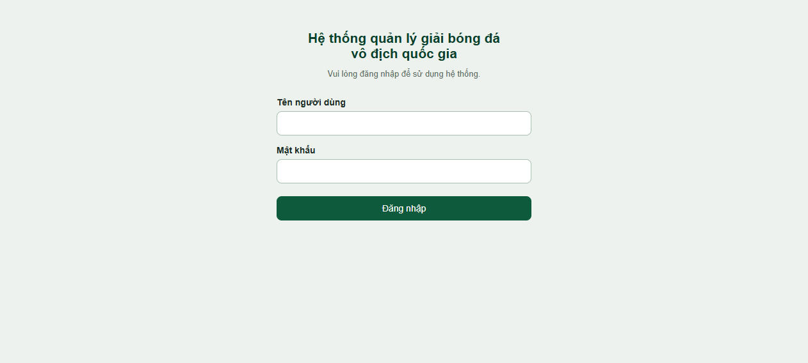

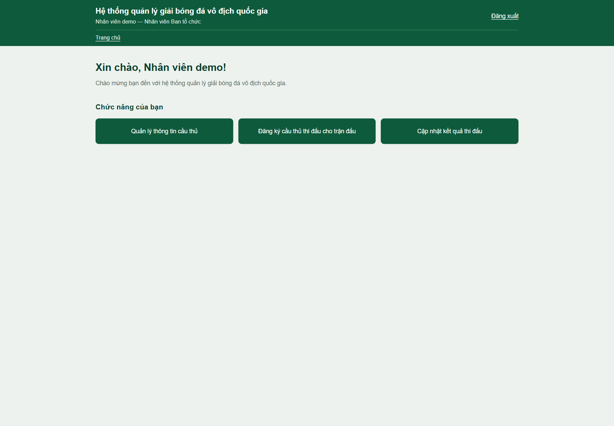

## 5. CN1 — Quản lý thông tin cầu thủ

### Cách sử dụng

1. Đăng nhập Staff → **Quản lý thông tin cầu thủ**.
2. Nhập tên hoặc mã cầu thủ để tìm kiếm.
3. Chọn **Thêm cầu thủ mới**, nhập họ tên, ngày sinh, quốc tịch, vị trí, email, số điện thoại, chiều cao và cân nặng → xác nhận lưu.
4. Hệ thống tạo hồ sơ và tài khoản trong cùng transaction. Mã đăng nhập tự sinh dạng `CTxxx`, ít nhất ba chữ số và không giới hạn ở 999; mật khẩu mặc định `player@123`.
5. Tìm lại cầu thủ → **Sửa** → lưu thay đổi.
6. Chọn **Xóa** và xác nhận nếu hồ sơ không có quan hệ CLB/lịch sử liên quan. Hệ thống từ chối xóa hồ sơ có dữ liệu liên quan để bảo toàn lịch sử.

Thêm/sửa lỗi không được để lại bản ghi dở dang giữa `users` và `players`. CN1 hiện chưa có cơ chế CSRF chung; không coi việc chỉ nhận POST là chống CSRF.

### Luồng demo bằng hình ảnh

Các ảnh CN1 dưới đây giữ từ bộ walkthrough cũ: tên/mã cầu thủ và thông báo trong ảnh minh họa thao tác, không đại diện dữ liệu hiện tại hoặc mã tài khoản tiếp theo.

**Bước 1 — Tìm kiếm cầu thủ.** Mở chức năng quản lý, nhập tên/mã và xem danh sách kết quả.

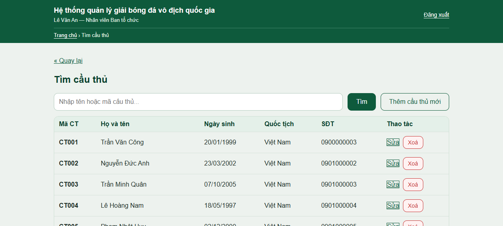

**Bước 2 — Thêm cầu thủ.** Nhập thông tin hồ sơ và xác nhận lưu; khi thành công hệ thống thông báo tài khoản được cấp.

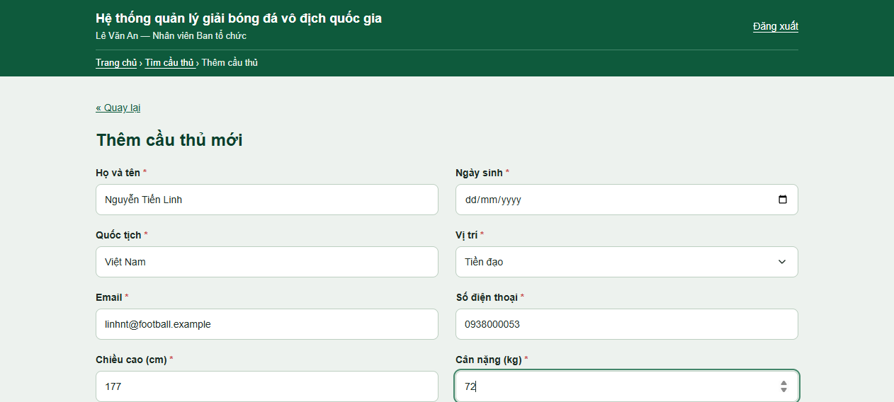

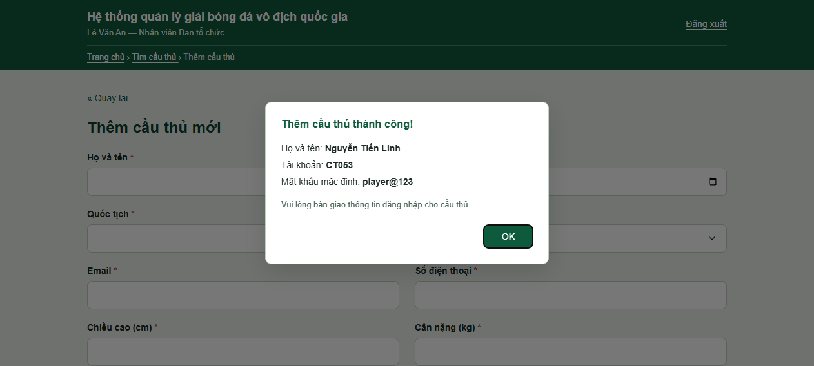

**Bước 3 — Sửa hồ sơ.** Tìm lại cầu thủ, mở form sửa và cập nhật thông tin.

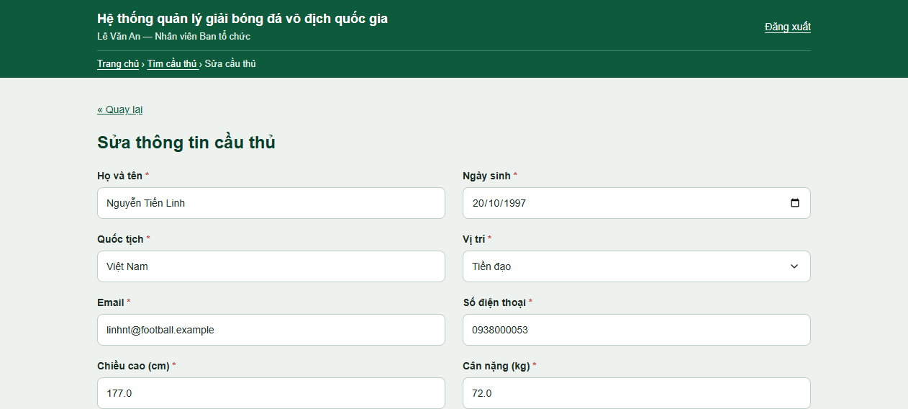

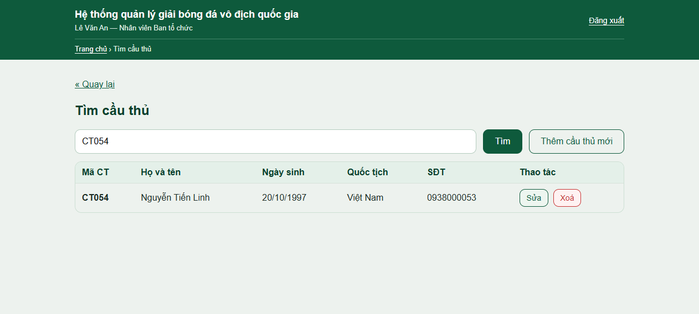

**Bước 4 — Xóa hồ sơ chưa có dữ liệu liên quan.** Kiểm tra đúng cầu thủ trước khi xác nhận; không xóa hồ sơ đang có lịch sử để làm demo.

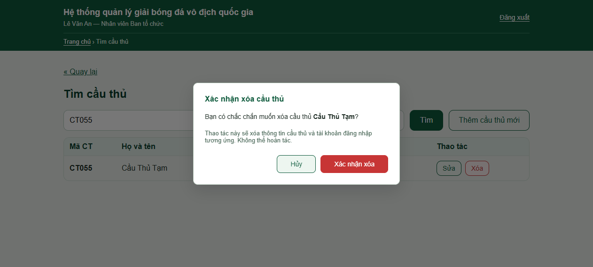

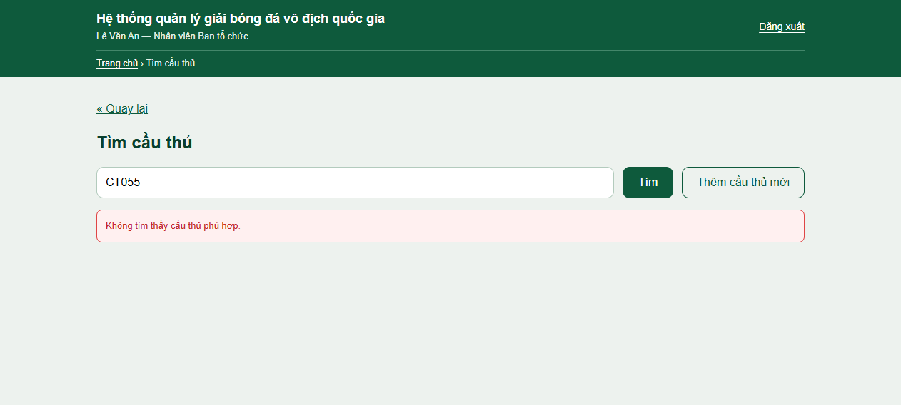

## 6. CN2 — Đăng ký cầu thủ thi đấu

### Cách sử dụng

1. Từ trang chủ Staff chọn **Đăng ký cầu thủ thi đấu cho trận đấu**.
2. Tìm và chọn mùa giải, ví dụ `LPBank` hoặc `2026` → tìm vòng, ví dụ `R07` → chọn trận, ví dụ `R07-T01`.
3. Trang **Thông tin trận đấu** hiển thị thời gian, sân nhà, hai CLB và đội hình đã lưu.
4. Chọn **Đăng ký / thay thế đội hình** ở đúng phía HOME hoặc AWAY.
5. Với từng cầu thủ, chọn **Đá chính**, **Dự bị** hoặc không chọn; theo dõi bộ đếm và điều lệ trên màn hình.
6. Lưu → quay về thông tin trận; thông báo thành công tự ẩn sau 3 giây khi JavaScript hoạt động. Làm tương tự cho bên còn lại; lưu một bên không thay đội hình bên kia.
7. Tìm lại trận từ đầu để xem dữ liệu đã lưu. Khi báo ngữ cảnh/form cũ, quay về tìm trận thay vì gửi lại tab cũ.

### Luồng demo bằng hình ảnh

Các ảnh CN2/CN3 được chụp từ ứng dụng đang chạy ngày 10/11/2026, chỉ mở màn hình, không gửi thao tác ghi. `R07-T01` trong runtime đã có đội hình hai bên, khác trạng thái dataset sau import sạch.

**Bước 1 — Tìm mùa giải.** Chọn mùa chính LPBank V.League 1 2026/27.

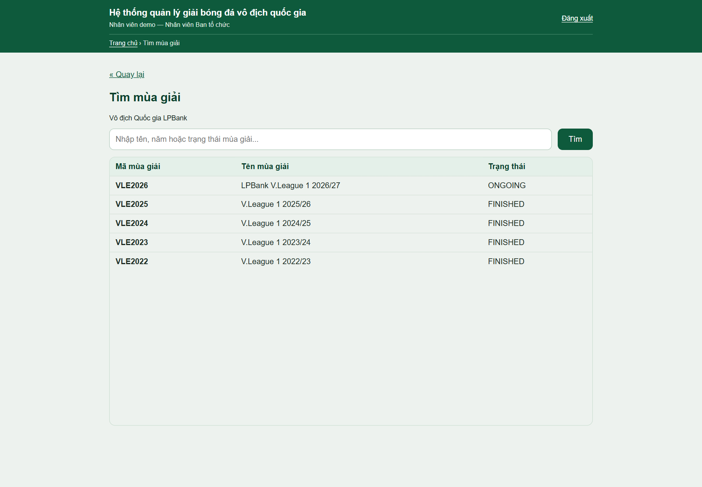

**Bước 2 — Tìm vòng đấu.** Nhập `R07` rồi chọn vòng 7.

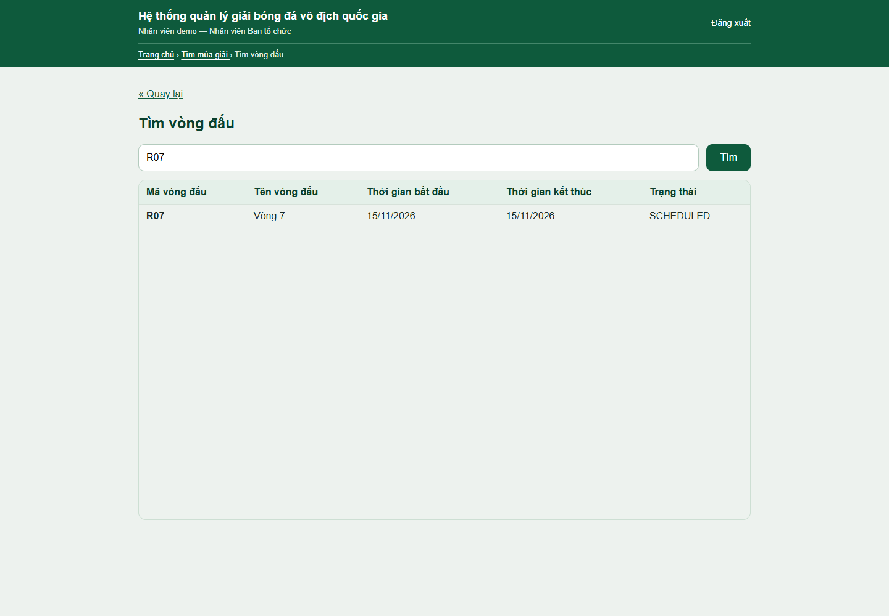

**Bước 3 — Chọn trận đấu.** Xem đội nhà, đội khách, kickoff và tình trạng đăng ký.

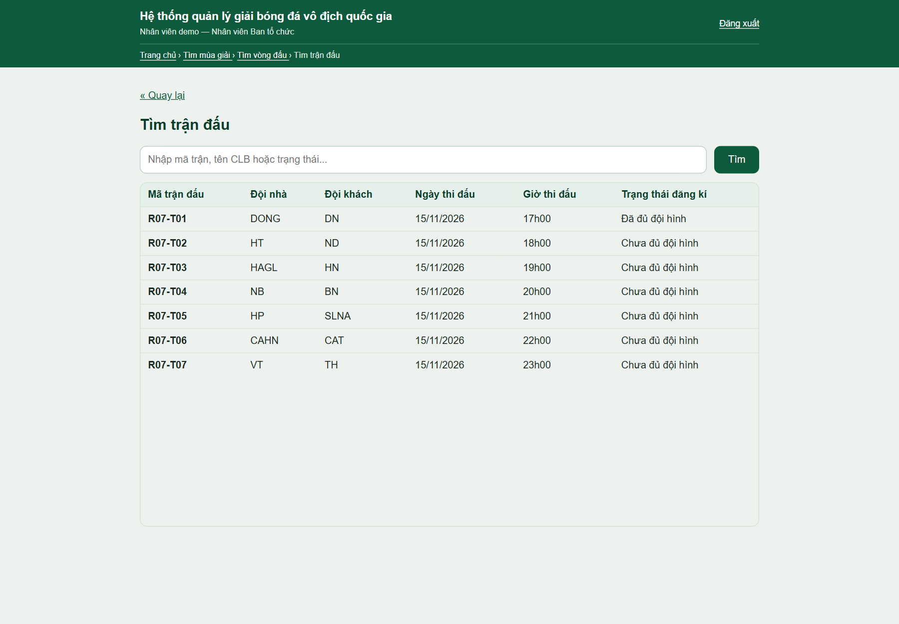

**Bước 4 — Xem đội hình HOME/AWAY.** Mỗi bên có liên kết đăng ký riêng; ảnh đang hiển thị dữ liệu đã lưu từ trước.

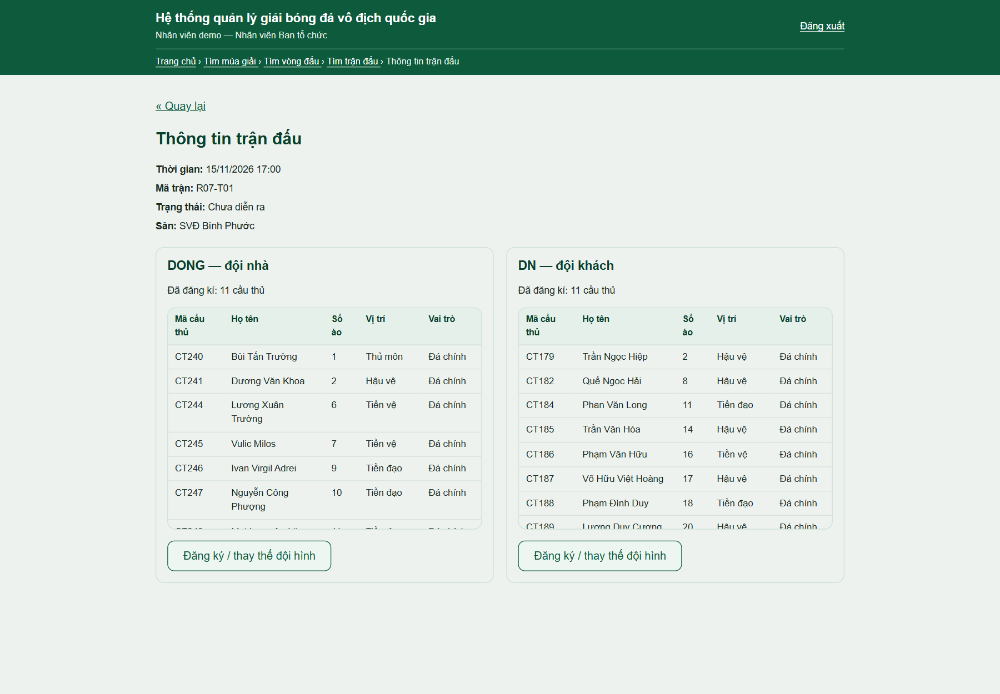

**Bước 5 — Đăng ký hoặc thay thế đội hình.** Chọn vai trò từng cầu thủ, kiểm tra bộ đếm/điều lệ rồi lưu. Sau khi lưu thành công sẽ quay về màn hình thông tin trận ở bước 4; ảnh form dưới đây chưa gửi lưu trong lượt chụp.

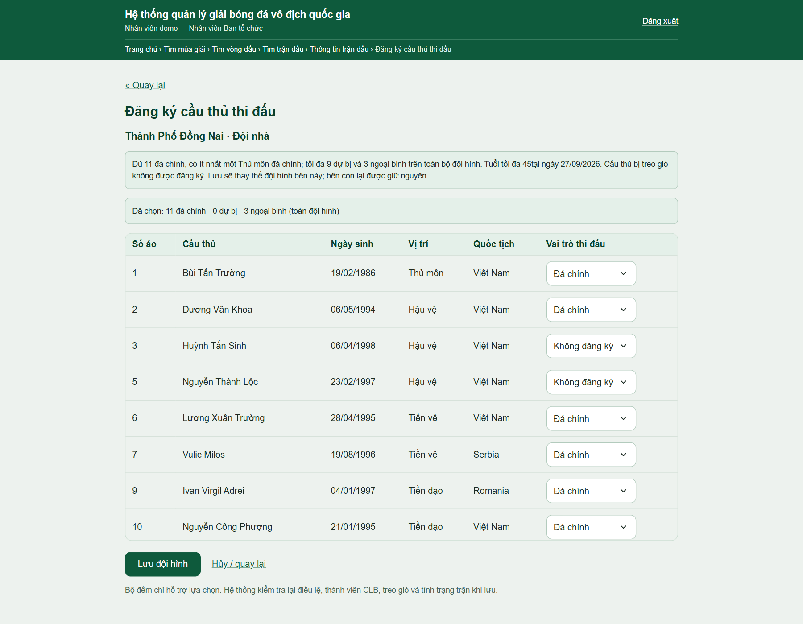

### Điều kiện lưu

- Trận phải `SCHEDULED`, chưa tới kickoff, kickoff đã xác định và chưa có sự kiện.
- Đúng **11 đá chính**, ít nhất một người có vị trí **Thủ môn**. `requiredMainPlayers` khác 11 là lỗi cấu hình.
- Không vượt số dự bị và ngoại binh theo Rule; quota ngoại binh tính trên cả đá chính lẫn dự bị. Quốc tịch trim, không phân biệt hoa/thường: `Việt Nam` là nội binh, giá trị khác là ngoại binh; thiếu bị từ chối.
- Tuổi tính tại ngày khai mạc mùa, không vượt `ageLimit`; ngày sinh thiếu hoặc sau ngày khai mạc bị từ chối.
- Cầu thủ phải thuộc CLB và không đang treo giò. Mỗi ngưỡng vàng và mỗi RedCard tạo một trận cấm, cộng dồn theo mùa; chấp hành ở trận FINISHED tiếp theo của CLB nhận thẻ theo kickoff. Hai vàng không tự sinh RedCard.
- Server kiểm tra lại dữ liệu trong transaction; form cũ khác DB bị từ chối. Cache chỉ cập nhật sau commit; đăng ký được giữ lại bảo toàn ID và thời điểm đăng ký.

### Ca demo sau import sạch

| Trận / cầu thủ | Trạng thái thiết kế trong dataset |
|---|---|
| `R07-T01` | HOME và AWAY chưa đăng ký |
| `R07-T02` | HOME có 11 chính + 3 dự bị, AWAY chưa đăng ký |
| `CT241` ở `R07-T01` | Đã chấp hành xong án |
| `CT242`, `CT243` ở `R07-T01` | Đang bị cấm thi đấu |

**Runtime đã sử dụng có thể khác snapshot này.** Không reset hoặc import lại dataset chỉ để làm lại walkthrough; kiểm tra đội hình thực tế trên trang.

## 7. CN3 — Cập nhật kết quả thi đấu

### Cách sử dụng

1. Trang chủ Staff → **Cập nhật kết quả thi đấu** → tìm mùa → vòng → trận.
2. Trang **Sự kiện trận đấu** hiển thị tỷ số, trạng thái và diễn biến. Hai bên phải có đội hình hợp lệ trước khi thêm sự kiện hoặc kết thúc trận; nếu thiếu, đăng ký qua CN2 khi còn được phép.
3. Chọn **Thêm sự kiện**, chọn CLB, loại sự kiện, phút thi đấu, phút bù giờ, cầu thủ chính, cầu thủ liên quan và ghi chú.
4. Lưu → trở về diễn biến với sự kiện và tỷ số mới. Lỗi validation giữ lựa chọn để sửa.
5. Chọn **Kết thúc trận đấu** khi muốn chốt kết quả. Trận 0–0 được phép kết thúc; sau chốt không thể thêm sự kiện.

### Luồng demo bằng hình ảnh

**Bước 1 — Chọn trận theo mùa → vòng → trận.** Các màn hình tìm kiếm giống CN2, bắt đầu từ menu **Cập nhật kết quả thi đấu**. Ảnh dưới là `R07-T01` trước khi có sự kiện; có nút thêm sự kiện và kết thúc trận.

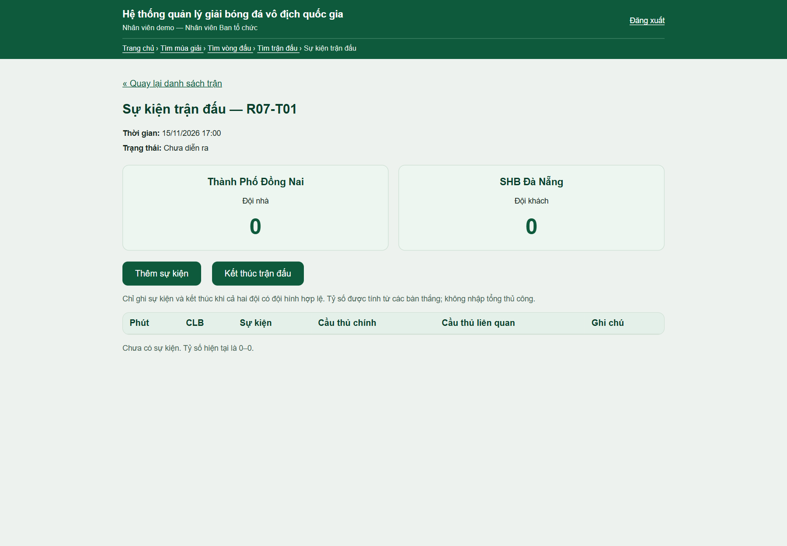

**Bước 2 — Mở form thêm sự kiện.** Chọn CLB, loại, phút thi đấu và cầu thủ tương ứng. Ảnh chỉ minh họa form, chưa gửi lưu; lưu hợp lệ sẽ quay về diễn biến với sự kiện mới.

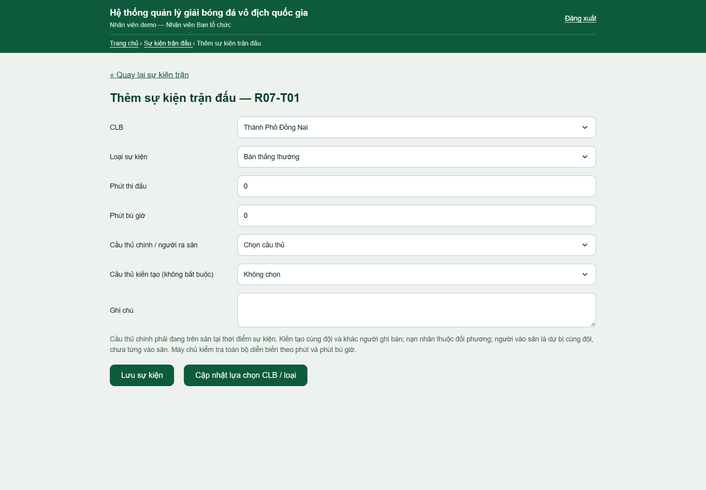

**Bước 3 — Xem tỷ số, diễn biến và trạng thái đã chốt.** Đây là trận mẫu khác `R01-T01`, đã kết thúc từ dữ liệu demo với tỷ số 3–1; không phải kết quả vừa ghi lên `R07-T01` trong lượt chụp. Sau khi kết thúc, trang khóa thêm sự kiện.

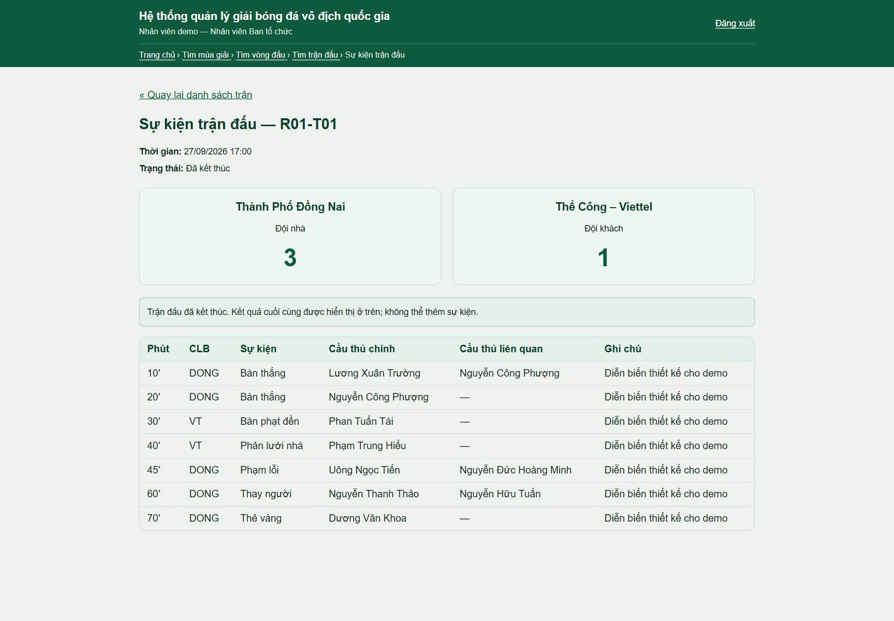

| Loại sự kiện | Cầu thủ chính / liên quan | Tác động |
|---|---|---|
| Bàn thắng thường (`NORMAL`) | Người ghi bàn; kiến tạo cùng đội tùy chọn | Cộng một bàn cho đội ghi bàn |
| Phạt đền (`PENALTY`) | Người ghi bàn; không có kiến tạo | Cộng một bàn cho đội ghi bàn |
| Phản lưới (`OWN`) | Người phản lưới; không có kiến tạo | Cộng một bàn cho đối phương |
| Phạm lỗi (`Foul`) | Người phạm lỗi và nạn nhân đối phương | Lưu diễn biến |
| Thẻ vàng / đỏ | Người nhận thẻ; không có cầu thủ liên quan | Lưu thẻ, làm nguồn tính treo giò |
| Thay người (`Substitution`) | Người ra sân và dự bị cùng đội vào sân | Cập nhật diễn biến vào/ra sân |

### Giới hạn cần lưu ý

- Nhận trận `SCHEDULED`/`ONGOING`; sự kiện đầu tiên chuyển `ONGOING`, kết thúc chuyển `FINISHED`. Không có nút bắt đầu trận riêng.
- Phút và bù giờ là số nguyên không âm; ghi chú tối đa 255 ký tự.
- Cầu thủ thực hiện sự kiện, kiến tạo, nạn nhân phải đang trên sân tại thời điểm tương ứng. Không cho người đã ra sân/thẻ đỏ tiếp tục tham gia; người vào sân chỉ vào một lần, số lần thay theo Rule.
- Thêm sự kiện lùi thời điểm bị từ chối nếu làm sai diễn biến phía sau.
- Tỷ số được tính từ Goal qua `v_match_scores`, không nhập tổng tỷ số thủ công.
- **Không có sửa/xóa sự kiện hoặc mở lại trận.** Thêm sự kiện/kết thúc là ghi dữ liệu thật; chỉ chốt trận khi thực sự muốn khóa kết quả.
- Để xem mẫu mà không ghi dữ liệu, mở `R01-T01` (dataset có tỷ số 3–1 và nhiều loại sự kiện) hoặc `R01-T02` (0–0); cả hai đã kết thúc.

CN2/CN3 dùng chung `SessionContext` dưới khóa session `sessionContext`; `currentUser` vẫn là nguồn xác thực duy nhất. URL GET dùng mã dễ đọc, ví dụ `/index.jsp?page=match-event&season=VLE2026&round=R07&match=T01`, không đưa UUID `flow`, `ready` hoặc ID nội bộ lên thanh địa chỉ. Mã được đối chiếu theo mùa → vòng → trận trong kết quả đã tải; mã không tồn tại hoặc không duy nhất bị từ chối. POST vẫn mang CSRF, phiên bản flow và ID thực trong hidden input; tab cũ bị từ chối sau khi ngữ cảnh thay đổi. Thiếu/hết session cần đăng nhập và tìm lại ngữ cảnh.

## 8. Dữ liệu và cấu trúc dự án

Dataset có **1 giải, 5 mùa, 14 CLB, 316 cầu thủ, 26 vòng và 182 trận mùa chính**. Bốn mùa cũ chỉ có thông tin mùa. Vòng 1–6 FINISHED; vòng 7 cách ngày mốc ít nhất bảy ngày, các vòng sau theo tuần. Snapshot thiết kế có 1.190 đăng ký và 14 sự kiện.

Tên CLB, hồ sơ và cặp đấu dựa nguồn [VPF](https://vpf.vn/season/v-league-2027/?action=calendar&pagejs=1); ngày đã dịch theo lịch demo. Đội hình, diễn biến và Rule phục vụ demo, không phải biên bản VPF đã xác minh. Lần refresh trước chỉ 4/387 request hồ sơ trả HTTP 200; không tuyên bố xác minh trực tiếp toàn bộ 316 hồ sơ. Repo không còn file bằng chứng nguồn chi tiết.

`rounds.number` dương và duy nhất theo mùa, độc lập tên vòng. Mã hiển thị `R07-T01` dùng số vòng và thứ tự ID trận trong toàn vòng trước lọc, không theo kickoff. URL GET dùng `season=VLE2026&round=R07&match=T01`; model, POST và FK vẫn dùng ID thực. Các mã URL không thay thế khóa database. Thời gian chưa xác định có thể NULL; CN2 khóa lưu khi kickoff NULL.

| Đường dẫn | Vai trò |
|---|---|
| `src/main/java/com/footballmanager/model/` | Model miền, quan hệ đối tượng một chiều, kế thừa Event |
| `src/main/java/com/footballmanager/dao/` | SQL, mapping, validation nghiệp vụ và transaction |
| `src/main/java/com/footballmanager/util/` | Escape HTML và ngữ cảnh luồng trận đấu |
| `src/main/webapp/index.jsp` | Điều hướng GET và kiểm tra quyền |
| `src/main/webapp/WEB-INF/views/` | Giao diện JSP và fragment dùng chung |
| `src/main/webapp/do*.jsp` | Handler POST |
| `src/main/webapp/assets/` | CSS, JavaScript thuần |
| `database/schema.sql`, `database/dataset.sql` | Schema/nâng cấp và dữ liệu demo kèm audit |
| `src/test/java/` | JUnit tích hợp PostgreSQL trên schema UUID cô lập |
| `docs/` | [Phân tích](docs/Phan-tich-Analysis-Class-Diagram.md), thiết kế [CN1](docs/Pha-Thiet-Ke-CN1.md), [CN2](docs/Pha-Thiet-Ke-CN2.md), [CN3](docs/Pha-Thiet-Ke-CN3.md) |

## 9. Nâng cấp database đang có dữ liệu

Không chạy dataset. Dừng web, backup custom, xem danh mục và phục hồi thử vào database cô lập trước khi chạy schema:

```powershell
docker compose stop web
New-Item -ItemType Directory -Force backups | Out-Null
docker compose exec -T db pg_dump -U football_app -d football_db -Fc -f /tmp/before-schema-upgrade.dump
docker compose cp db:/tmp/before-schema-upgrade.dump backups/before-schema-upgrade.dump
docker compose exec -T db pg_restore -l /tmp/before-schema-upgrade.dump
docker compose exec -T db createdb -U football_app football_restore_check
docker compose exec -T db pg_restore -U football_app --exit-on-error --no-owner -d football_restore_check /tmp/before-schema-upgrade.dump
docker compose cp database/schema.sql db:/tmp/football-schema.sql
docker compose exec -T db psql -X -v ON_ERROR_STOP=1 -U football_app -d football_db -f /tmp/football-schema.sql
```

Chọn tên backup/database phục hồi chưa dùng, không ghi đè bản cần giữ; backup chứa tài khoản, không commit. Migration điền `rounds.number` từ tên chuẩn `Vòng N` một lần khi thiếu số; tên không xác định hoặc trùng số làm rollback để sửa mapping rõ ràng, không suy số từ ID. Số đã lưu được giữ khi đổi tên vòng.

Nếu nâng cấp lỗi, giữ web dừng và xử lý lỗi trước khi chạy lại. Không dùng dataset để sửa migration. Sau nâng cấp thành công, build/recreate web theo mục 2 và đăng nhập lại. **Không dùng `docker compose down -v` trên dữ liệu cần giữ.**

## 10. Kiểm thử và vận hành

### Integration test

Dùng database kiểm thử riêng, không trỏ vào `football_db`. Test tự tạo/xóa schema UUID; cần user có quyền tạo schema.

```powershell
$env:CN2_TEST_JDBC_URL = 'jdbc:postgresql://127.0.0.1:5433/football_test'
$env:CN2_TEST_DB_USER = 'football_app'
# Nạp CN2_TEST_DB_PASSWORD từ cấu hình bí mật của môi trường.
.\mvnw.cmd "-Dtest=Cn2LineupIntegrationTest,Cn2TournamentIntegrationTest,Cn3EventIntegrationTest" test
```

Thiếu `CN2_TEST_*` thì integration test skipped, không phải pass nghiệp vụ. Audit trong dataset chỉ dành cho snapshot ban đầu, không dùng lại sau khi Staff thay dữ liệu. Smoke thao tác ghi cần dữ liệu kiểm thử riêng, không sửa/xóa dữ liệu đang dùng chỉ để kiểm chứng.

### Lệnh vận hành

```powershell
docker compose ps
docker compose logs --tail=100 web
docker compose logs --tail=100 db
docker compose stop
# Chạy lại image hiện có, không rebuild:
docker compose up -d --wait
```

### Lỗi thường gặp

- **Không kết nối Docker API / thiếu pipe `dockerDesktopLinuxEngine`:** mở Docker Desktop, bật Linux engine rồi chạy lại Compose; có thể dùng `docker desktop start` nếu CLI hỗ trợ.
- **Thiếu `rounds.number`:** nâng cấp schema, không sửa DAO về suy số từ tên. Nếu chỉ IDE gạch đỏ, chọn dialect PostgreSQL/datasource đúng và refresh metadata.
- **`Only DEFAULT may be inserted into generated column`:** chạy nguyên dataset bằng `psql`, giữ `OVERRIDING SYSTEM VALUE`.
- **`Dataset requires empty application tables`:** không seed chồng; dùng database trống hoặc chỉ nâng cấp schema.
- **CN2 khóa lưu:** kiểm tra trạng thái, kickoff, sự kiện và điều lệ hiện tại; không đổi ngày/trạng thái dữ liệu thật để bỏ khóa.
- **Form/ngữ cảnh hết hiệu lực:** tìm lại mùa → vòng → trận; tránh gửi lại tab cũ sau khi đổi ngữ cảnh.

### Kiểm chứng lần chạy lại ngày 10/11/2026

- `mvnw.cmd package -DskipTests` thành công; không chạy lại integration suite trong lần này.
- Đã khởi động Docker Desktop và build/recreate web; Compose báo PostgreSQL và web healthy.
- Browser đăng nhập Staff, mở CN1 với 316 dòng cầu thủ; đi luồng CN2 đến `R07-T01`; đi luồng CN3 đến `R01-T01`, đọc tỷ số 3–1 và trạng thái khóa FINISHED.
- Chỉ kiểm tra đọc dữ liệu; không reset database, không thêm/xóa cầu thủ, thay đội hình hoặc ghi/chốt trận trong lần chạy này.

### Kiểm chứng SessionContext và URL ngắn ngày 10/11/2026

- `mvnw.cmd package` đạt 52 tests, không failures/errors/skipped: 46 PostgreSQL tests và 6 tests điều hướng/session. Đã build WAR/image và recreate runtime 8088 healthy; cần đăng nhập lại để bỏ context cũ.
- CN2 dùng `page=season-search`, `round-search`, `match-search`; CN3 dùng các route tìm kiếm tương ứng có hậu tố `-events`, vẫn render cùng JSP. Hai trang cuối dùng `page=match-info` / `match-event` và `season=VLE2026&round=R07&match=T01`; form đội hình thêm `side=HOME` hoặc `AWAY`. Không còn UUID/ready/ID nội bộ trên GET URL; tìm kiếm rỗng bỏ `key=`.
- Browser trên database bản sao `football_session_smoke_20261110`/web 8089 đã lưu đội hình, kiểm tra lỗi thiếu 11 chính giữ lựa chọn, thêm bàn thắng, kết thúc và reload tỷ số 1–0. Thiếu CSRF bị 403, POST sự kiện cũ bị 400, form đội hình cũ báo lỗi ngữ cảnh. Giả lập truy vấn vòng lỗi trên database cô lập xác nhận không tái sử dụng kết quả con của mùa trước.
- Runtime 8088 chỉ kiểm tra đọc CN2/CN3 với URL mới; trận R07-T01 vẫn SCHEDULED 0–0. Manager/Player/User bị 403 ở route mới và ba POST; CN1 tìm cầu thủ và logout hoạt động. Không đổi dữ liệu nghiệp vụ runtime, không chạy migration/reset. Web smoke 8089 đã dừng.


### Quy ước phát triển

Giữ kiến trúc JSP–DAO và giao diện tiếng Việt. SQL khai báo biến `String` riêng trước JDBC; dùng prepared statement, text block nhiều dòng, keyword hoa, mỗi cột SELECT và clause/predicate xuống dòng. Dữ liệu động HTML escape bằng `HTMLUtil`; URL theo context path. Thao tác nhiều bảng atomic, cache chỉ đổi sau commit.

Formatter: IntelliJ IDEA 2026.2.3, `config/code-style.xml`, `.editorconfig` (UTF-8, LF, 4 spaces). Đặt `$env:IDEA_HOME`, chạy `.\format.cmd`; cần plugin Jakarta EE: Server Pages. Không format lại dataset bằng công cụ làm hỏng cú pháp `psql`. `DESIGN.md` chỉ tham khảo template giao diện, báo cáo trong `docs/` quyết định mô hình/nghiệp vụ.

## Giấy phép

Dự án phục vụ mục đích học tập.
