# Hệ thống quản lý giải bóng đá vô địch quốc gia

Đồ án môn học **Phân tích và thiết kế hệ thống thông tin**

- **Giảng viên hướng dẫn:** PGS. TS. Nguyễn Mạnh Hùng
- **Trường:** Học viện Công nghệ Bưu chính Viễn thông (PTIT)

## Giới thiệu

Hệ thống hỗ trợ Ban tổ chức giải quản lý toàn bộ dữ liệu của giải vô địch quốc gia: hồ sơ cầu thủ, đăng ký thi đấu và cập nhật kết quả các trận đấu.

## Chức năng

| # | Chức năng | Mô tả | Trạng thái |
|---|-----------|-------|------------|
| 1 | **Quản lý thông tin cầu thủ** | Tìm kiếm, thêm mới, sửa thông tin, xoá cầu thủ | ✅ Hoàn thành (kèm đăng nhập/đăng xuất) |
| 2 | **Đăng ký cầu thủ thi đấu cho trận đấu** | Đội bóng đăng ký danh sách cầu thủ tham dự mỗi trận | ⚪ Đang phát triển |
| 3 | **Cập nhật kết quả thi đấu** | Nhập tỷ số, cập nhật kết quả các trận đấu | ⚪ Đang phát triển |

## Công nghệ sử dụng

- **Ngôn ngữ:** Java 17 (JSP/Servlet, kiến trúc JSP Model 2)
- **Web container:** Apache Tomcat 10.1 (Jakarta EE)
- **CSDL:** PostgreSQL 17 (mã hoá mật khẩu bằng BCrypt qua `pgcrypto`)
- **Build:** Maven (kèm Maven Wrapper)
- **Triển khai:** Docker + Docker Compose

## Cấu trúc dự án

```
football-manager/
├── database/                    # Script khởi tạo CSDL
│   ├── schema.sql               # Bảng users, managers, staff, players
│   ├── users.sql                # Tài khoản mẫu
│   ├── players.sql              # 50 cầu thủ mẫu
│   └── player_code_sequence.sql # Sequence sinh mã cầu thủ CTxxx
├── src/main/java/com/footballmanager/
│   ├── dao/                     # DAO: DAO, UserDAO, PlayerDAO, ...
│   ├── model/                   # Model: User, Staff, Player, Manager
│   └── util/                    # Tiện ích (HTMLUtil chống XSS)
├── src/main/webapp/
│   ├── index.jsp                # Front controller điều hướng trang
│   ├── doLogin.jsp / doLogout.jsp / doAddPlayer.jsp / doEditPlayer.jsp   # Xử lý POST
│   ├── WEB-INF/views/           # Các giao diện (gdHome, gdLogin, ...)
│   └── assets/                  # CSS, JS
├── docker-compose.yaml
└── Dockerfile
```

## Hướng dẫn cài đặt

### Yêu cầu môi trường

- [Docker Desktop](https://www.docker.com/products/docker-desktop/) (có sẵn Docker Compose)
- **Hoặc** cài thủ công: JDK 17, Maven, PostgreSQL 14+, Tomcat 10.1

### Cách 1: Chạy bằng Docker (khuyến nghị)

**1. Tạo file cấu hình môi trường**

```bash
cp .env.example .env
```

Sửa nội dung `.env`:

```env
JDBC_URL=jdbc:postgresql://localhost:5433/football_db
DB_USER=football_app
DB_PASSWORD=football_dev_2026   # đặt mật khẩu tuỳ ý
```

**2. Build file WAR**

```bash
./mvnw clean package        # Windows: .\mvnw.cmd clean package
```

**3. Khởi động PostgreSQL và ứng dụng**

```bash
docker compose up -d --build
```

- PostgreSQL chạy tại `localhost:5433` (user `football_app`, db `football_db`)
- Ứng dụng chạy tại: <http://localhost:8088>

**4. Khởi tạo dữ liệu cho CSDL** (chạy 1 lần, các script an toàn khi chạy lại)

```bash
docker exec -i football-postgres psql -U football_app -d football_db < database/schema.sql
docker exec -i football-postgres psql -U football_app -d football_db < database/users.sql
docker exec -i football-postgres psql -U football_app -d football_db < database/players.sql
docker exec -i football-postgres psql -U football_app -d football_db < database/player_code_sequence.sql
```

**5. Truy cập:** <http://localhost:8088>

### Cách 2: Chạy thủ công (Tomcat ngoài)

1. Tạo database `football_db` và chạy lần lượt 4 script trong thư mục `database/` (pgcrypto cần quyền superuser: `CREATE EXTENSION pgcrypto;`).
2. Build WAR: `./mvnw clean package`
3. Deploy `target/football-manager.war` vào Tomcat 10.1.
4. Cấu hình biến môi trường cho Tomcat: `JDBC_URL`, `DB_USER`, `DB_PASSWORD` (ví dụ trong `.env.example`).
5. Truy cập `http://localhost:8080/football-manager`.

### Tài khoản mẫu

| Tài khoản | Mật khẩu | Vai trò |
|-----------|----------|---------|
| `NV001` | `staff@123` | Nhân viên Ban tổ chức — quản lý cầu thủ |
| `QL001` | `manager@123` | Quản lý đội bóng |
| `CT001` | `player@123` | Cầu thủ |
| `khangia` | `spectator@123` | Khán giả |

> Cầu thủ mới được thêm tự động cấp tài khoản `CTxxx` / mật khẩu mặc định `player@123`.

## Luồng demo: Thêm cầu thủ mới (Chức năng 1)

Đây là luồng đầu tiên đã hoàn thành. Nhân viên Ban tổ chức đăng nhập, khai báo hồ sơ cầu thủ; hệ thống tự sinh mã cầu thủ `CTxxx` và tài khoản đăng nhập.

### Các bước thực hiện

| # | Màn hình | Mô tả |
|---|----------|-------|
| 1 | Đăng nhập | Nhân viên đăng nhập bằng tài khoản `NV001` |
| 2 | Trang chủ | Chọn chức năng **Quản lý thông tin cầu thủ** (chỉ hiện với nhân viên) |
| 3 | Tìm cầu thủ | Danh sách cầu thủ + ô tìm kiếm theo tên/mã; bấm **Thêm cầu thủ mới** |
| 4 | Form thêm cầu thủ | Khai báo họ tên, ngày sinh, quốc tịch, vị trí, email, SĐT, chiều cao, cân nặng |
| 5 | Xác nhận lưu | Kiểm tra dữ liệu rồi bấm **Lưu cầu thủ** |
| 6 | Kết quả | Hộp thoại hiện mã cầu thủ `CTxxx` và mật khẩu mặc định để bàn giao |
| 7 | Tìm kiếm lại | Cầu thủ mới xuất hiện trong danh sách |

### Màn hình

**1. Đăng nhập** — nhân viên nhập tài khoản `NV001`:

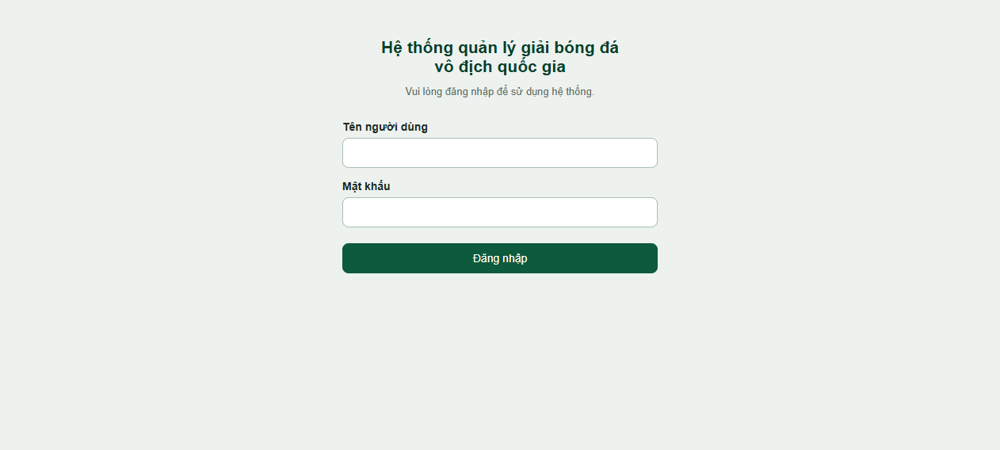

**2. Trang chủ** — sau khi đăng nhập, nhân viên thấy 3 chức năng (2 chức năng chưa mở vẫn ở trạng thái vô hiệu hóa):

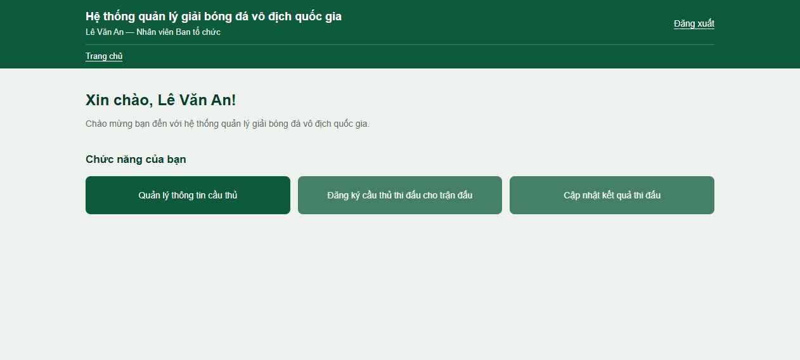

**3. Tìm cầu thủ** — danh sách cầu thủ, tìm kiếm theo tên hoặc mã cầu thủ:

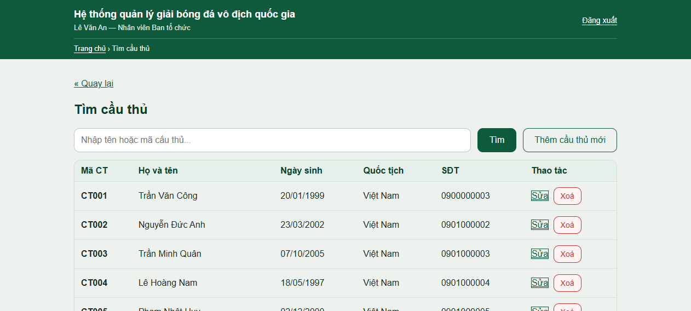

**4. Form thêm cầu thủ** — bấm **Thêm cầu thủ mới**, khai báo đầy đủ thông tin:

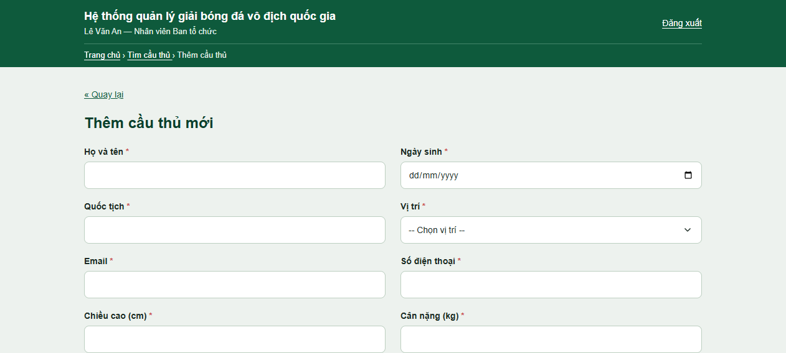

**5. Điền thông tin** — ví dụ cầu thủ Nguyễn Tiến Linh, vị trí Tiền đạo:

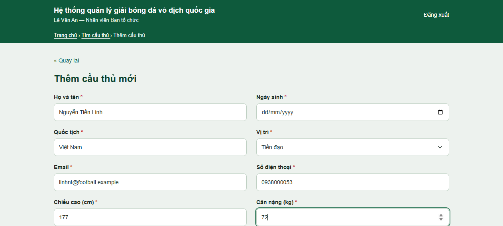

**6. Thêm thành công** — hệ thống tự sinh mã `CT054` và tài khoản/mật khẩu mặc định:

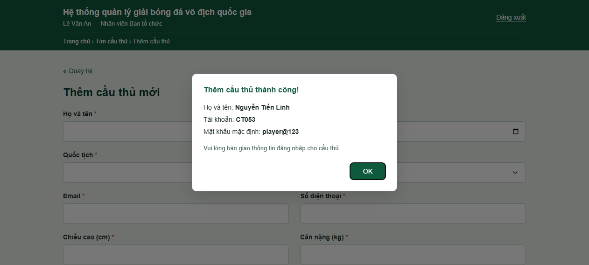

**7. Tìm kiếm cầu thủ mới** — cầu thủ `CT054` đã có trong hệ thống:

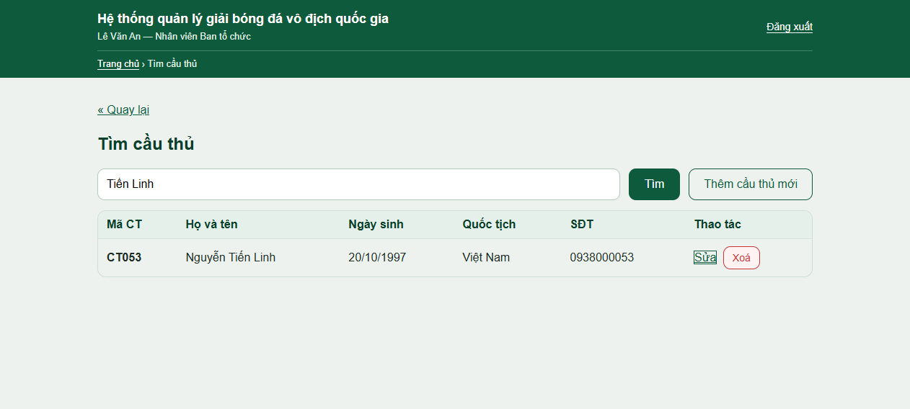

### Diễn giải luồng (kỹ thuật)

1. `gdPlayerForm.jsp` hiển thị form; người dùng submit POST tới `doAddPlayer.jsp`.
2. `doAddPlayer.jsp` kiểm tra phiên đăng nhập (phải là `Staff`), kiểm tra dữ liệu bắt buộc.
3. `PlayerDAO.addPlayer()` mở transaction:
   - Lấy mã cầu thủ tiếp theo từ sequence `player_code_seq` → username `CTxxx`;
   - Thêm bản ghi vào bảng `users` (mật khẩu mặc định `player@123`, băm BCrypt);
   - Thêm bản ghi vào bảng `players` (quốc tịch, vị trí, chiều cao, cân nặng);
   - Commit — nếu lỗi sẽ rollback toàn bộ.
4. Thành công: redirect về form, hiển thị hộp thoại thông tin tài khoản để bàn giao cho cầu thủ.

## Luồng demo: Sửa thông tin cầu thủ (Chức năng 1)

Nhân viên tìm cầu thủ cần sửa trong danh sách, bấm **Sửa**, hệ thống hiển thị form đã điền sẵn thông tin hiện tại; sau khi lưu, thay đổi được cập nhật vào CSDL.

### Các bước thực hiện

| # | Màn hình | Mô tả |
|---|----------|-------|
| 1 | Tìm cầu thủ | Bấm **Sửa** trên hàng của cầu thủ cần chỉnh sửa |
| 2 | Form sửa | Thông tin hiện tại được điền sẵn; nhân viên chỉnh các trường cần thay đổi |
| 3 | Lưu | Bấm **Lưu thay đổi** |
| 4 | Kết quả | Hộp thoại xác nhận cập nhật thành công |
| 5 | Tìm kiếm lại | Thông tin cầu thủ đã được cập nhật |

### Màn hình

**1. Form sửa cầu thủ** — thông tin hiện tại của cầu thủ `CT054` điền sẵn:

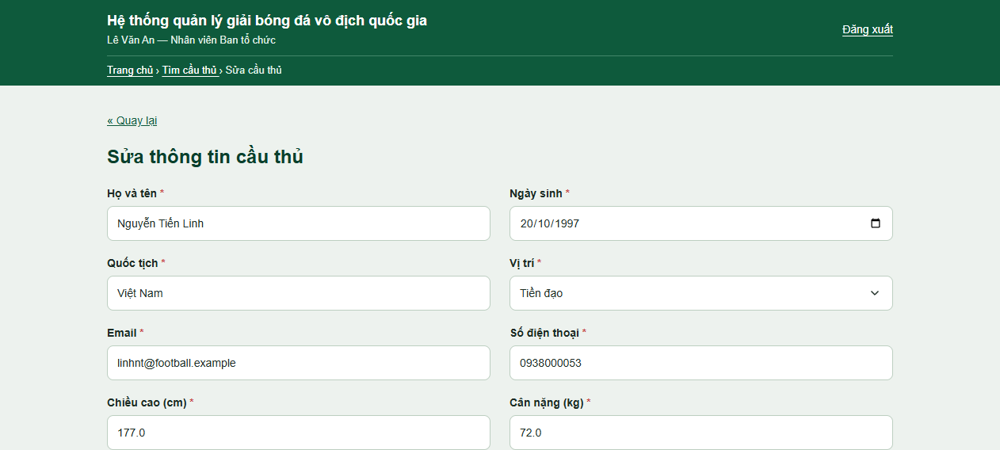

**2. Chỉnh sửa** — đổi email, chiều cao, cân nặng:

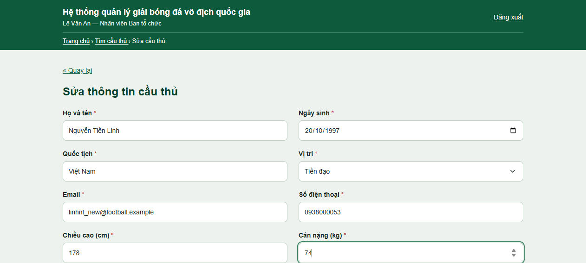

**3. Cập nhật thành công**:

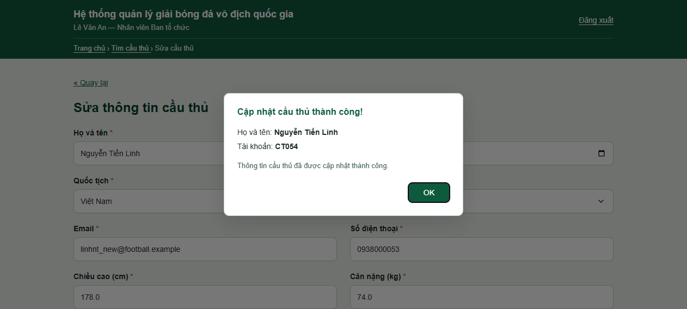

**4. Thông tin đã cập nhật** — cầu thủ `CT054` với email/chiều cao/cân nặng mới:

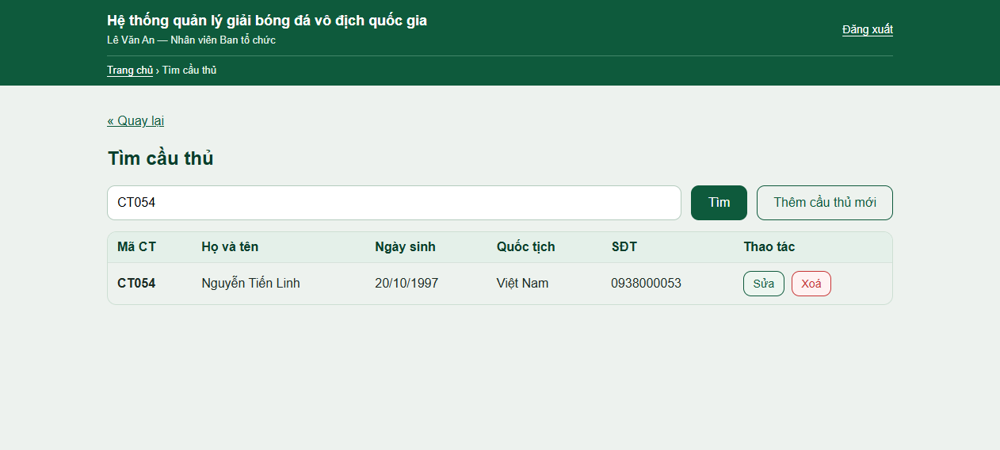

### Diễn giải luồng (kỹ thuật)

1. Từ danh sách tìm kiếm (`gdPlayerSearch.jsp`), bấm **Sửa** → `index.jsp?page=player-edit&id=...`
2. `gdPlayerForm.jsp` tìm cầu thủ trong danh sách của phiên, lưu vào `selectedPlayer` và hiển thị form điền sẵn; form submit tới `doEditPlayer.jsp`.
3. `doEditPlayer.jsp` kiểm tra phiên đăng nhập (phải là `Staff`), kiểm tra dữ liệu, gọi `PlayerDAO.updatePlayer()`.
4. `updatePlayer()` mở transaction cập nhật bảng `users` (họ tên, ngày sinh, email, SĐT) và bảng `players` (quốc tịch, vị trí, chiều cao, cân nặng); chỉ commit khi cả hai bản ghi đều cập nhật thành công, ngược lại rollback.
5. Thành công: redirect về form, hiển thị hộp thoại xác nhận.

## Luồng demo: Xoá cầu thủ (Chức năng 1)

Nhân viên bấm **Xóa** trên hàng của cầu thủ trong danh sách, xác nhận trong hộp thoại; hệ thống xoá hồ sơ và tài khoản của cầu thủ khỏi CSDL.

### Các bước thực hiện

| # | Màn hình | Mô tả |
|---|----------|-------|
| 1 | Xác nhận xóa | Hộp thoại hiện tên cầu thủ, cảnh báo không thể hoàn tác; bấm **Xác nhận xóa** |
| 2 | Kết quả | Hộp thoại thông báo xóa thành công |
| 3 | Tìm kiếm lại | Cầu thủ đã biến mất khỏi hệ thống |

### Màn hình

**1. Hộp thoại xác nhận xóa**:

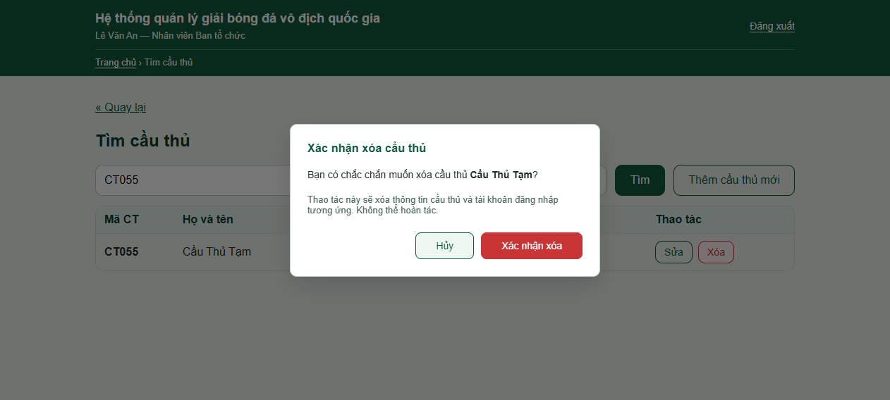

**2. Xóa thành công**:

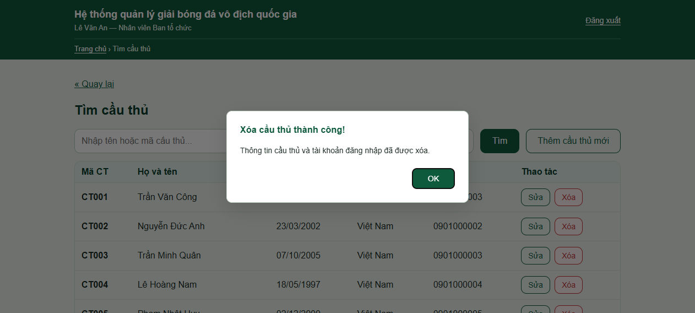

**3. Cầu thủ đã bị xóa** — tìm không còn thấy:

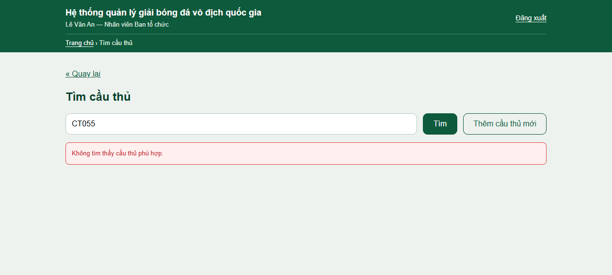

### Diễn giải luồng (kỹ thuật)

1. `search.js` bắt sự kiện nút **Xóa**, điền id cầu thủ vào form và mở hộp thoại xác nhận.
2. Xác nhận → POST `player-id` tới `doDeletePlayer.jsp` (yêu cầu phiên `Staff`).
3. `PlayerDAO.deletePlayer()` xoá bản ghi `users` (cascade xoá `players`) — chỉ xoá khi id đó thực sự là cầu thủ.
4. Kết quả lưu vào session, redirect về trang tìm kiếm; hộp thoại kết quả tự mở qua `search.js`.

## Giấy phép

Dự án phục vụ mục đích học tập.
