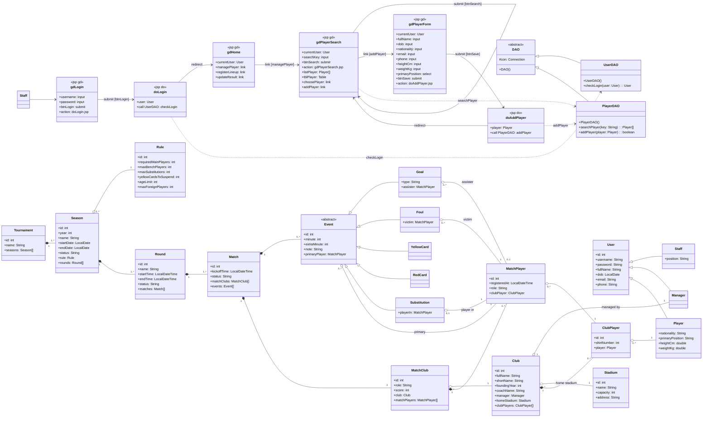
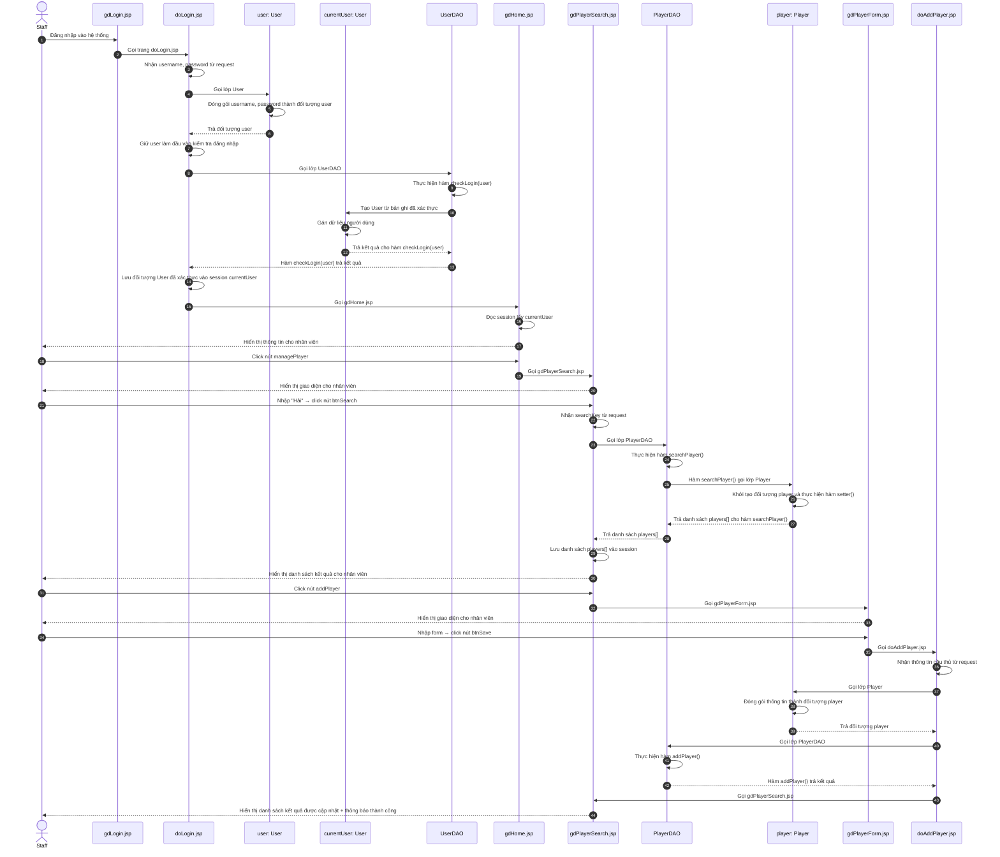

# PHA THIẾT KẾ — CHỨC NĂNG 1: THÊM CẦU THỦ

Kiến trúc: **JSP – DAO**, không Controller. Java + JSP + PostgreSQL (JDBC).

> **Phạm vi hiện thực:** đăng nhập qua `UserDAO.checkLogin(User)`, session duy nhất cho danh tính là `currentUser: User`; không dùng session `staff`. `index.jsp` hiển thị `WEB-INF/views/gdHome.jsp`. CN1 và CN2 là phạm vi hiện thực; CN3 vẫn là thiết kế, menu không được mô tả như luồng cập nhật kết quả đã chạy. Ký hiệu `T[]` trong biểu đồ là tập đối tượng; Java dùng `List<T>`. Đồ thị đối tượng chỉ đi từ `Tournament.seasons` xuống dưới, không có tham chiếu ngược từ Season.

> **Contract dữ liệu 08/11/2026:** giữ `Season.name`/`seasons.name`; số vòng và số thứ tự trận chỉ là dữ liệu hiển thị derived trong Java, không có cột `round_number`/`match_number` hay cờ mô phỏng. Số vòng suy từ tên chuẩn `Vòng 1` ... `Vòng 26` (fallback ổn định nếu tên không có số); thứ tự trận theo ID trong toàn vòng trước khi lọc, không theo kickoff. Mã như `R07-T01` không thay ID dùng trong URL/session/FK.

> **Bộ demo:** 1 Tournament, 5 Season (2026/27 là mùa chính; bốn mùa cũ chỉ có thông tin mùa), 14 CLB, 26 vòng/182 trận mùa chính. Cặp đấu và hồ sơ CLB/cầu thủ dựa VPF; ngày được dịch theo mốc seed, đội hình/sự kiện phục vụ ca nghiệp vụ. Nguồn và phần bổ sung ghi ngoài database, không gắn nhãn/cảnh báo mô phỏng trên UI; mọi thẻ đều tính treo giò theo luật CN2. Dữ liệu sự kiện không đồng nghĩa triển khai CN3.

---

## 1. THIẾT KẾ TĨNH — FULL VIEW CLASS DIAGRAM

### 1.1. Tầng giao diện gồm các trang .jsp

**Giao diện Đăng nhập: gdLogin.jsp**
- Thuộc tính tường minh:
  - username: input
  - password: input
  - btnLogin: submit
- Thuộc tính ẩn: không có
- Submit form tới doLogin.jsp (action) để kiểm tra đăng nhập.

**Giao diện chính nhân viên BTC: gdHome.jsp**
- Thuộc tính tường minh:
  - managePlayer: link
  - registerLineup: link
  - updateResult: link
- Thuộc tính ẩn:
  - currentUser: User
- Không gọi DAO — đọc session lấy currentUser, hiển thị thông tin + menu.

**Giao diện tìm cầu thủ: gdPlayerSearch.jsp**
- Thuộc tính tường minh:
  - searchKey: input
  - btnSearch: submit
  - tblPlayer: Table
  - choosePlayer: link
  - addPlayer: link
- Thuộc tính ẩn:
  - currentUser: User
  - listPlayer: Player[]
- Submit về chính trang này (action: self): nhận searchKey từ param, gọi PlayerDAO thực hiện searchPlayer().

**Giao diện thêm cầu thủ: gdPlayerForm.jsp**
- Thuộc tính tường minh:
  - fullName: input
  - dob: input
  - nationality: input
  - email: input
  - phone: input
  - heightCm: input
  - weightKg: input
  - primaryPosition: select
  - btnSave: submit
- Thuộc tính ẩn:
  - currentUser: User
- Submit form tới doAddPlayer.jsp (action) để lưu cầu thủ mới vào hệ thống.

### 1.2. Tầng thao tác dữ liệu có các lớp DAO

**UserDAO:**
- Phương thức checkLogin(user: User): User

**PlayerDAO (kế thừa DAO):**
- Phương thức searchPlayer(key: String): Player[]
- Phương thức addPlayer(player: Player): boolean

### 1.3. Tầng thực thể

Gồm tất cả các thực thể liên quan (xem biểu đồ).

### 1.4. Biểu đồ Full View

---

## 2. MÔ TẢ ACTIVITY DIAGRAM

**Các activity đại diện cho các lớp giao diện, kèm các action của giao diện**

**gdLogin.jsp**
- Hiện giao diện đăng nhập

**doLogin.jsp**
- Nhận thông tin từ param username / password
- Tạo đối tượng User (đóng gói username, password) làm dữ liệu đầu vào (không lưu thông tin đăng nhập vào session)
- Gọi UserDAO thực hiện checkLogin(user) — kiểm tra đăng nhập
- Lưu đối tượng User đã xác thực vào session currentUser
- Hiển thị lỗi bằng request attribute khi đăng nhập sai
- Redirect index.jsp để hiển thị gdHome.jsp nếu đăng nhập đúng; forward gdLogin.jsp nếu sai

**gdHome.jsp**
- Nhận currentUser từ session
- Hiện giao diện (thông tin nhân viên + menu)
- Nhân viên click nút managePlayer → chuyển gdPlayerSearch.jsp

**gdPlayerSearch.jsp**
- Hiện giao diện (form tìm kiếm)
- Nhận searchKey từ param khi nhân viên click nút btnSearch
- Gọi PlayerDAO thực hiện searchPlayer() — lấy danh sách cầu thủ khớp từ khoá
- Hiện danh sách cầu thủ cho nhân viên

**gdPlayerForm.jsp**
- Hiện giao diện (form nhập cầu thủ)
- Lấy thông tin cầu thủ nhập vào (họ tên, ngày sinh, quốc tịch, email, phone, chiều cao, cân nặng, vị trí)

**doAddPlayer.jsp**
- Nhận thông tin cầu thủ từ param
- Gọi lớp Player đóng gói thành đối tượng Player
- Gọi PlayerDAO thực hiện addPlayer() — lưu thông tin cầu thủ vào CSDL
- Chuyển về gdPlayerSearch.jsp
- Hiển thị thông báo thành công nếu thêm thành công / thông báo lỗi nếu thêm không thành công

---

---

## 3. THIẾT KẾ ĐỘNG

### 3.1. Kịch bản

| Bước | Nội dung thao tác |
|---|---|
| 1 | Nhân viên BTC thực hiện đăng nhập vào hệ thống |
| 2 | gdLogin.jsp gọi trang doLogin.jsp |
| 3 | doLogin.jsp nhận username, password từ request |
| 4 | doLogin.jsp gọi lớp User |
| 5 | Lớp User đóng gói username, password thành đối tượng user |
| 6 | Lớp User trả đối tượng user cho doLogin.jsp |
| 7 | doLogin.jsp giữ user làm đầu vào kiểm tra đăng nhập |
| 8 | doLogin.jsp gọi lớp UserDAO |
| 9 | UserDAO thực hiện hàm checkLogin(user) |
| 10 | Hàm checkLogin(user) đọc bản ghi người dùng |
| 11 | UserDAO tạo User đã xác thực từ bản ghi |
| 12 | UserDAO trả User cho hàm checkLogin(user) |
| 13 | Hàm checkLogin(user) trả kết quả cho doLogin.jsp |
| 14 | doLogin.jsp lưu đối tượng User đã xác thực vào session currentUser |
| 15 | doLogin.jsp gọi gdHome.jsp |
| 16 | gdHome.jsp đọc session lấy currentUser |
| 17 | gdHome.jsp hiển thị thông tin cho nhân viên |
| 18 | Nhân viên BTC click nút managePlayer |
| 19 | gdHome.jsp gọi gdPlayerSearch.jsp |
| 20 | gdPlayerSearch.jsp hiển thị giao diện cho nhân viên |
| 21 | Nhân viên BTC nhập "Hải", click nút btnSearch |
| 22 | gdPlayerSearch.jsp nhận searchKey từ request |
| 23 | gdPlayerSearch.jsp gọi lớp PlayerDAO |
| 24 | PlayerDAO thực hiện hàm searchPlayer() |
| 25 | Hàm searchPlayer() thực hiện và gọi lớp Player |
| 26 | Lớp Player khởi tạo đối tượng player và thực hiện hàm setter() |
| 27 | Lớp Player trả danh sách players[] cho hàm searchPlayer() |
| 28 | Hàm searchPlayer() trả danh sách players[] cho gdPlayerSearch.jsp |
| 29 | gdPlayerSearch.jsp lưu danh sách players[] vào session |
| 30 | gdPlayerSearch.jsp hiển thị danh sách kết quả cho nhân viên |
| 31 | Nhân viên BTC click nút addPlayer |
| 32 | gdPlayerSearch.jsp gọi gdPlayerForm.jsp |
| 33 | gdPlayerForm.jsp hiển thị giao diện cho nhân viên |
| 34 | Nhân viên BTC nhập form, click nút btnSave |
| 35 | gdPlayerForm.jsp gọi doAddPlayer.jsp |
| 36 | doAddPlayer.jsp nhận thông tin cầu thủ từ request |
| 37 | doAddPlayer.jsp gọi lớp Player |
| 38 | Lớp Player đóng gói thông tin thành đối tượng player |
| 39 | Lớp Player trả đối tượng player cho doAddPlayer.jsp |
| 40 | doAddPlayer.jsp gọi lớp PlayerDAO |
| 41 | PlayerDAO thực hiện hàm addPlayer() |
| 42 | Hàm addPlayer() thực hiện và trả kết quả cho doAddPlayer.jsp |
| 43 | doAddPlayer.jsp gọi gdPlayerSearch.jsp |
| 44 | gdPlayerSearch.jsp hiển thị danh sách kết quả được cập nhật + thông báo thành công |

### 3.2. Sequence Diagram

