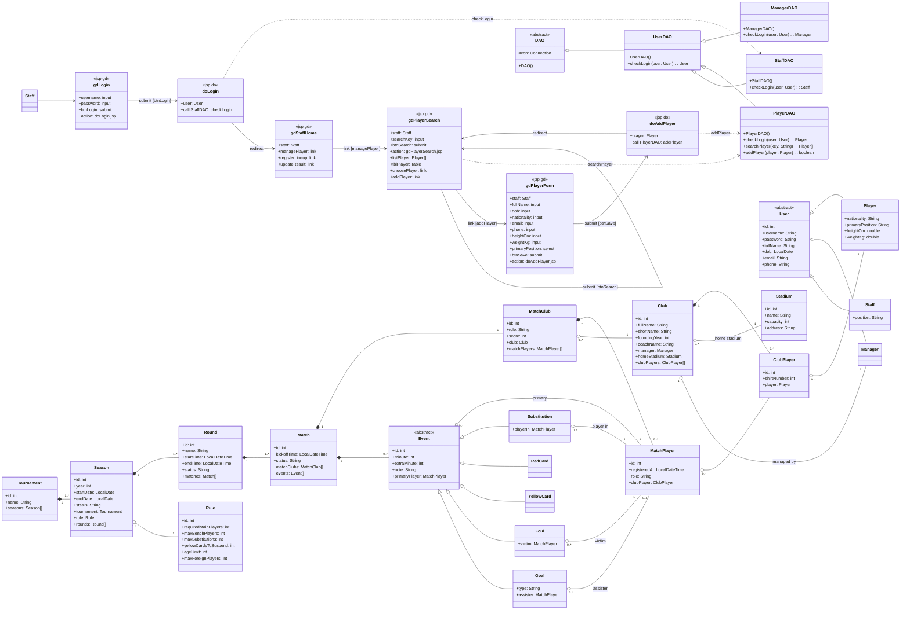
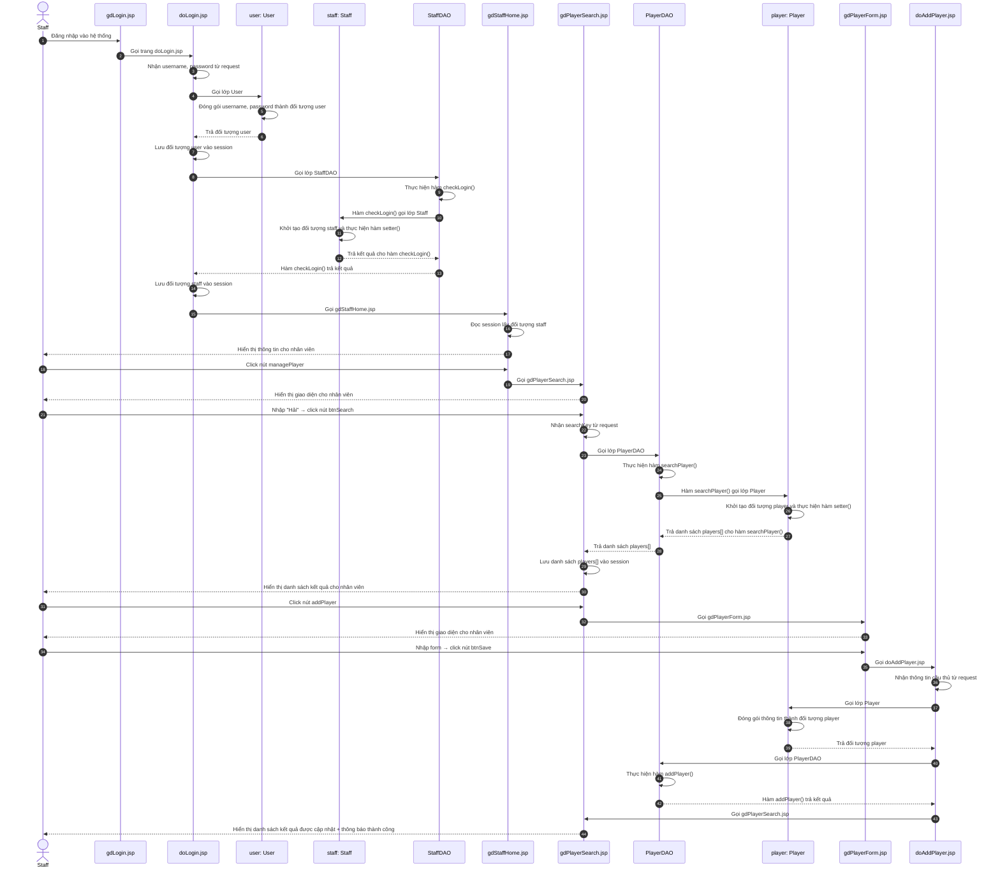

# PHA THIẾT KẾ — CHỨC NĂNG 1: THÊM CẦU THỦ

Kiến trúc: **JSP – DAO**, không Controller. Java + JSP + MySQL.

---

## 1. THIẾT KẾ TĨNH — FULL VIEW CLASS DIAGRAM

### 1.1. Tầng giao diện gồm các trang .jsp

**Giao diện Đăng nhập: gdLogin.jsp**
- Thuộc tính tường minh:
  - username: input
  - password: input
  - btnLogin: submit
- Thuộc tính ẩn: không có
- Submit form tới doLogin.jsp (action) để kiểm tra đăng nhập.

**Giao diện chính nhân viên BTC: gdStaffHome.jsp**
- Thuộc tính tường minh:
  - managePlayer: link
  - registerLineup: link
  - updateResult: link
- Thuộc tính ẩn:
  - staff: Staff
- Không gọi DAO — đọc session lấy đối tượng staff, hiển thị thông tin + menu.

**Giao diện tìm cầu thủ: gdPlayerSearch.jsp**
- Thuộc tính tường minh:
  - searchKey: input
  - btnSearch: submit
  - tblPlayer: Table
  - choosePlayer: link
  - addPlayer: link
- Thuộc tính ẩn:
  - staff: Staff
  - listPlayer: Player[]
- Submit về chính trang này (action: self): nhận searchKey từ param, gọi PlayerDAO thực hiện searchPlayer().

**Giao diện thêm cầu thủ: gdPlayerForm.jsp**
- Thuộc tính tường minh:
  - fullName: input
  - dob: input
  - nationality: input
  - email: input
  - phone: input
  - heightCm: input
  - weightKg: input
  - primaryPosition: select
  - btnSave: submit
- Thuộc tính ẩn:
  - staff: Staff
- Submit form tới doAddPlayer.jsp (action) để lưu cầu thủ mới vào hệ thống.

### 1.2. Tầng thao tác dữ liệu có các lớp DAO

**UserDAO:**
- Phương thức checkLogin(user: User): User

**StaffDAO (kế thừa từ UserDAO):**
- Phương thức checkLogin(user: User): Staff — override, setter đầy đủ thông tin ngay trong checkLogin

**PlayerDAO (kế thừa từ UserDAO):**
- Phương thức searchPlayer(key: String): Player[]
- Phương thức addPlayer(player: Player): boolean

### 1.3. Tầng thực thể

Gồm tất cả các thực thể liên quan (xem biểu đồ).

### 1.4. Biểu đồ Full View

---

## 2. MÔ TẢ ACTIVITY DIAGRAM

**Các activity đại diện cho các lớp giao diện, kèm các action của giao diện**

**gdLogin.jsp**
- Hiện giao diện đăng nhập

**doLogin.jsp**
- Nhận thông tin từ param username / password
- Tạo đối tượng User (đóng gói username, password) và lưu vào session
- Gọi StaffDAO thực hiện checkLogin() — kiểm tra đăng nhập
- Lưu đối tượng staff hoàn chỉnh vào session
- Hiển thị thông báo lỗi từ param nếu đăng nhập sai
- Chuyển tới gdStaffHome.jsp nếu đăng nhập đúng, quay lại gdLogin.jsp nếu sai

**gdStaffHome.jsp**
- Nhận thông tin staff từ session
- Hiện giao diện (thông tin nhân viên + menu)
- Nhân viên click nút managePlayer → chuyển gdPlayerSearch.jsp

**gdPlayerSearch.jsp**
- Hiện giao diện (form tìm kiếm)
- Nhận searchKey từ param khi nhân viên click nút btnSearch
- Gọi PlayerDAO thực hiện searchPlayer() — lấy danh sách cầu thủ khớp từ khoá
- Hiện danh sách cầu thủ cho nhân viên

**gdPlayerForm.jsp**
- Hiện giao diện (form nhập cầu thủ)
- Lấy thông tin cầu thủ nhập vào (họ tên, ngày sinh, quốc tịch, email, phone, chiều cao, cân nặng, vị trí)

**doAddPlayer.jsp**
- Nhận thông tin cầu thủ từ param
- Gọi lớp Player đóng gói thành đối tượng Player
- Gọi PlayerDAO thực hiện addPlayer() — lưu thông tin cầu thủ vào CSDL
- Chuyển về gdPlayerSearch.jsp
- Hiển thị thông báo thành công nếu thêm thành công / thông báo lỗi nếu thêm không thành công

---

---

## 3. THIẾT KẾ ĐỘNG

### 3.1. Kịch bản

| Bước | Nội dung thao tác |
|---|---|
| 1 | Nhân viên BTC thực hiện đăng nhập vào hệ thống |
| 2 | gdLogin.jsp gọi trang doLogin.jsp |
| 3 | doLogin.jsp nhận username, password từ request |
| 4 | doLogin.jsp gọi lớp User |
| 5 | Lớp User đóng gói username, password thành đối tượng user |
| 6 | Lớp User trả đối tượng user cho doLogin.jsp |
| 7 | doLogin.jsp lưu đối tượng user vào session |
| 8 | doLogin.jsp gọi lớp StaffDAO |
| 9 | StaffDAO thực hiện hàm checkLogin() |
| 10 | Hàm checkLogin() thực hiện và gọi lớp Staff |
| 11 | Lớp Staff khởi tạo đối tượng staff và thực hiện hàm setter() |
| 12 | Lớp Staff trả kết quả cho hàm checkLogin() |
| 13 | Hàm checkLogin() trả kết quả cho doLogin.jsp |
| 14 | doLogin.jsp lưu đối tượng staff vào session |
| 15 | doLogin.jsp gọi gdStaffHome.jsp |
| 16 | gdStaffHome.jsp đọc session lấy đối tượng staff |
| 17 | gdStaffHome.jsp hiển thị thông tin cho nhân viên |
| 18 | Nhân viên BTC click nút managePlayer |
| 19 | gdStaffHome.jsp gọi gdPlayerSearch.jsp |
| 20 | gdPlayerSearch.jsp hiển thị giao diện cho nhân viên |
| 21 | Nhân viên BTC nhập "Hải", click nút btnSearch |
| 22 | gdPlayerSearch.jsp nhận searchKey từ request |
| 23 | gdPlayerSearch.jsp gọi lớp PlayerDAO |
| 24 | PlayerDAO thực hiện hàm searchPlayer() |
| 25 | Hàm searchPlayer() thực hiện và gọi lớp Player |
| 26 | Lớp Player khởi tạo đối tượng player và thực hiện hàm setter() |
| 27 | Lớp Player trả danh sách players[] cho hàm searchPlayer() |
| 28 | Hàm searchPlayer() trả danh sách players[] cho gdPlayerSearch.jsp |
| 29 | gdPlayerSearch.jsp lưu danh sách players[] vào session |
| 30 | gdPlayerSearch.jsp hiển thị danh sách kết quả cho nhân viên |
| 31 | Nhân viên BTC click nút addPlayer |
| 32 | gdPlayerSearch.jsp gọi gdPlayerForm.jsp |
| 33 | gdPlayerForm.jsp hiển thị giao diện cho nhân viên |
| 34 | Nhân viên BTC nhập form, click nút btnSave |
| 35 | gdPlayerForm.jsp gọi doAddPlayer.jsp |
| 36 | doAddPlayer.jsp nhận thông tin cầu thủ từ request |
| 37 | doAddPlayer.jsp gọi lớp Player |
| 38 | Lớp Player đóng gói thông tin thành đối tượng player |
| 39 | Lớp Player trả đối tượng player cho doAddPlayer.jsp |
| 40 | doAddPlayer.jsp gọi lớp PlayerDAO |
| 41 | PlayerDAO thực hiện hàm addPlayer() |
| 42 | Hàm addPlayer() thực hiện và trả kết quả cho doAddPlayer.jsp |
| 43 | doAddPlayer.jsp gọi gdPlayerSearch.jsp |
| 44 | gdPlayerSearch.jsp hiển thị danh sách kết quả được cập nhật + thông báo thành công |

### 3.2. Sequence Diagram

