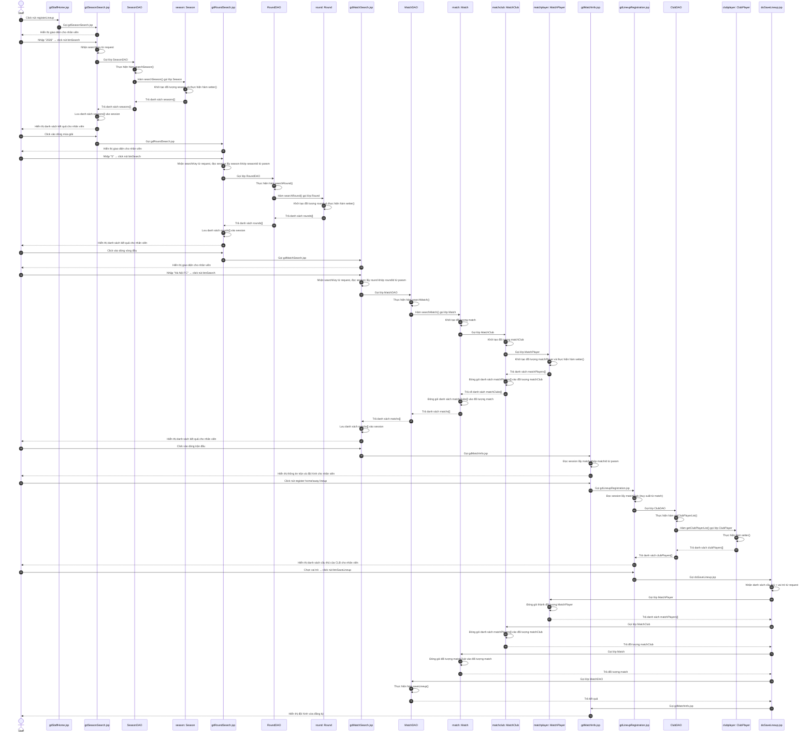

# PHA THIẾT KẾ — CHỨC NĂNG 2: ĐĂNG KÝ CẦU THỦ THI ĐẤU

Kiến trúc: **JSP – DAO**, không Controller. Java + JSP + MySQL.

> Staff đã đăng nhập ở CN1 — các trang này đều đọc session kiểm tra `staff: Staff`.

---

## 1. THIẾT KẾ TĨNH — FULL VIEW CLASS DIAGRAM

### 1.1. Tầng giao diện gồm các trang .jsp

**Giao diện tìm mùa giải: gdSeasonSearch.jsp**
- Thuộc tính tường minh:
  - searchKey: input
  - btnSearch: submit
  - tblSeason: Table
  - chooseSeason: link
- Thuộc tính ẩn:
  - staff: Staff
  - listSeason: Season[]
- Submit về chính trang này (action: self): nhận searchKey từ param, gọi SeasonDAO thực hiện searchSeason().

**Giao diện tìm vòng đấu: gdRoundSearch.jsp**
- Thuộc tính tường minh:
  - searchKey: input
  - btnSearch: submit
  - tblRound: Table
  - chooseRound: link
- Thuộc tính ẩn:
  - staff: Staff
  - season: Season (đọc session khớp seasonId từ param)
  - listRound: Round[]
- Submit về chính trang này (action: self): nhận searchKey từ param + đọc session lấy season, gọi RoundDAO thực hiện searchRound(season, key).

**Giao diện tìm trận đấu: gdMatchSearch.jsp**
- Thuộc tính tường minh:
  - searchKey: input
  - btnSearch: submit
  - tblMatch: Table
  - chooseMatch: link
- Thuộc tính ẩn:
  - staff: Staff
  - round: Round (đọc session khớp roundId từ param)
  - listMatch: Match[]
- Submit về chính trang này (action: self): nhận searchKey từ param + đọc session lấy round, gọi MatchDAO thực hiện searchMatch(round, key) — hàm tải trọn chuỗi ◆ (MatchPlayer → MatchClub → Match), lưu listMatch vào session.

**Giao diện thông tin trận: gdMatchInfo.jsp**
- Thuộc tính tường minh:
  - lblMatchTime: label
  - lblStadium: label
  - tblHomeLineup: Table
  - tblAwayLineup: Table
  - registerHome: link
  - registerAway: link
- Thuộc tính ẩn:
  - staff: Staff
  - match: Match (đọc session khớp matchId từ param — đã chứa đầy đủ matchClubs + matchPlayers từ searchMatch)
  - homeLineup: MatchPlayer[]
  - awayLineup: MatchPlayer[]
- Đọc session lấy match → hiển thị thông tin trận + 2 bảng đội hình. KHÔNG gọi DAO — đội hình đã có sẵn trong match từ searchMatch.

**Giao diện đăng ký đội hình: gdLineupRegistration.jsp**
- Thuộc tính tường minh:
  - tblPlayer: Table
  - roleSelect: select
  - btnSaveLineup: submit
- Thuộc tính ẩn:
  - staff: Staff
  - matchClub: MatchClub (truy xuất từ match trong session)
  - season: Season (đọc session)
  - listClubPlayer: ClubPlayer[]
- Đọc session lấy season + matchclub (truy xuất từ match), gọi ClubDAO thực hiện getClubPlayerList(club, season).

### 1.2. Tầng thao tác dữ liệu có các lớp DAO

**SeasonDAO:**
- Phương thức searchSeason(key: String): Season[]

**RoundDAO:**
- Phương thức searchRound(season: Season, key: String): Round[]

**MatchDAO (DAO của chủ thể Match — thao tác trên trung gian MatchClub/MatchPlayer):**
- Phương thức searchMatch(round: Round, key: String): Match[] — tải trọn chuỗi ◆: MatchPlayer → MatchClub → Match
- Phương thức saveLineup(match: Match, matchClub: MatchClub): boolean — match là đối tượng chủ thể; matchClub xác định bên đang đăng kí (đã chứa MatchPlayer[] mới, ClubPlayer đầy đủ từ session)

**ClubDAO (DAO của chủ thể Club — thao tác trên trung gian ClubPlayer):**
- Phương thức getClubPlayerList(club: Club, season: Season): ClubPlayer[]

> **Quy tắc trung gian:** MatchClub, ClubPlayer, MatchPlayer là lớp trung gian ◆ sinh từ quan hệ n–n — KHÔNG có DAO riêng. Thao tác qua DAO của chủ thể: MatchPlayer/MatchClub → MatchDAO, ClubPlayer → ClubDAO.

### 1.3. Tầng thực thể

Gồm tất cả các thực thể liên quan (xem biểu đồ).

### 1.4. Biểu đồ Full View

```mermaid
classDiagram
    direction LR

    class StaffActor["Staff"]
    class gdLogin {
        <<jsp gd>>
        +username: input
        +password: input
        +btnLogin: submit
        +action: doLogin.jsp
    }
    class doLogin {
        <<jsp do>>
        +user: User
        +call StaffDAO: checkLogin
    }
    class gdStaffHome {
        <<jsp gd>>
        +staff: Staff
        +managePlayer: link
        +registerLineup: link
        +updateResult: link
    }
    class gdSeasonSearch {
        <<jsp gd>>
        +staff: Staff
        +searchKey: input
        +btnSearch: submit
        +action: gdSeasonSearch.jsp
        +listSeason: Season[]
        +tblSeason: Table
        +chooseSeason: link
    }
    class gdRoundSearch {
        <<jsp gd>>
        +staff: Staff
        +season: Season
        +searchKey: input
        +btnSearch: submit
        +action: gdRoundSearch.jsp
        +listRound: Round[]
        +tblRound: Table
        +chooseRound: link
    }
    class gdMatchSearch {
        <<jsp gd>>
        +staff: Staff
        +round: Round
        +searchKey: input
        +btnSearch: submit
        +action: gdMatchSearch.jsp
        +listMatch: Match[]
        +tblMatch: Table
        +chooseMatch: link
    }
    class gdMatchInfo {
        <<jsp gd>>
        +staff: Staff
        +match: Match
        +lblMatchTime: label
        +lblStadium: label
        +homeLineup: MatchPlayer[]
        +tblHomeLineup: Table
        +awayLineup: MatchPlayer[]
        +tblAwayLineup: Table
        +registerHome: link
        +registerAway: link
    }
    class gdLineupRegistration {
        <<jsp gd>>
        +staff: Staff
        +matchClub: MatchClub
        +season: Season
        +listClubPlayer: ClubPlayer[]
        +tblPlayer: Table
        +roleSelect: select
        +btnSaveLineup: submit
        +action: doSaveLineup.jsp
    }
    class doSaveLineup {
        <<jsp do>>
        +listMatchPlayer: MatchPlayer[]
        +matchClub: MatchClub
        +match: Match
        +call MatchDAO: saveLineup
    }

    class DAO {
        <<abstract>>
        +DAO()
        #con: Connection
    }
    class UserDAO {
        +UserDAO()
        +checkLogin(user: User): User
    }
    class StaffDAO {
        +StaffDAO()
        +checkLogin(user: User): Staff
    }
    class SeasonDAO {
        +SeasonDAO()
        +searchSeason(key: String): Season[]
    }
    class RoundDAO {
        +RoundDAO()
        +searchRound(season: Season, key: String): Round[]
    }
    class MatchDAO {
        +MatchDAO()
        +searchMatch(round: Round, key: String): Match[]
        +saveLineup(match: Match, matchClub: MatchClub): boolean
    }
    class ClubDAO {
        +ClubDAO()
        +getClubPlayerList(club: Club, season: Season): ClubPlayer[]
    }
    DAO <|-- UserDAO
    UserDAO <|-- StaffDAO
    DAO <|-- SeasonDAO
    DAO <|-- RoundDAO
    DAO <|-- MatchDAO
    DAO <|-- ClubDAO

    class User {
        <<abstract>>
        +id: int
        +username: String
        +password: String
        +fullName: String
        +dob: LocalDate
        +email: String
        +phone: String
    }
    class Staff {
        +position: String
    }
    class Manager {
    }
    class Player {
        +nationality: String
        +primaryPosition: String
        +heightCm: double
        +weightKg: double
    }
    class Tournament {
        +id: int
        +name: String
        +seasons: Season[]
    }
    class Season {
        +id: int
        +year: int
        +startDate: LocalDate
        +endDate: LocalDate
        +status: String
        +tournament: Tournament
        +rule: Rule
        +rounds: Round[]
    }
    class Rule {
        +id: int
        +requiredMainPlayers: int
        +maxBenchPlayers: int
        +maxSubstitutions: int
        +yellowCardsToSuspend: int
        +ageLimit: int
        +maxForeignPlayers: int
    }
    class Round {
        +id: int
        +name: String
        +startTime: LocalDateTime
        +endTime: LocalDateTime
        +status: String
        +matches: Match[]
    }
    class Match {
        +id: int
        +kickoffTime: LocalDateTime
        +status: String
        +matchClubs: MatchClub[]
        +events: Event[]
    }
    class MatchClub {
        +id: int
        +role: String
        +score: int
        +club: Club
        +matchPlayers: MatchPlayer[]
    }
    class ClubPlayer {
        +id: int
        +shirtNumber: int
        +player: Player
    }
    class MatchPlayer {
        +id: int
        +registeredAt: LocalDateTime
        +role: String
        +clubPlayer: ClubPlayer
    }
    class Event {
        <<abstract>>
        +id: int
        +minute: int
        +extraMinute: int
        +note: String
        +primaryPlayer: MatchPlayer
    }
    class Goal {
        +type: String
        +assister: MatchPlayer
    }
    class Foul {
        +victim: MatchPlayer
    }
    class YellowCard {
    }
    class RedCard {
    }
    class Substitution {
        +playerIn: MatchPlayer
    }
    class Club {
        +id: int
        +fullName: String
        +shortName: String
        +foundingYear: int
        +coachName: String
        +manager: Manager
        +homeStadium: Stadium
        +clubPlayers: ClubPlayer[]
    }
    class Stadium {
        +id: int
        +name: String
        +capacity: int
        +address: String
    }

    User <|-- Staff
    User <|-- Manager
    User <|-- Player
    Event <|-- Goal
    Event <|-- Foul
    Event <|-- YellowCard
    Event <|-- RedCard
    Event <|-- Substitution
    Tournament "1" *-- "1..*" Season
    Season "0..*" o-- "1" Rule
    Season "1" *-- "1..*" Round
    Round "1" *-- "1..*" Match
    Match "1" *-- "0..*" Event
    Club "1" o-- "1" Manager : managed by
    Club "0..*" o-- "1" Stadium : home stadium
    Match "1" *-- "2" MatchClub
    MatchClub "0..*" o-- "1" Club
    Club "1" *-- "0..*" ClubPlayer
    ClubPlayer "0..*" o-- "1" Player
    MatchClub "1" *-- "0..*" MatchPlayer
    MatchPlayer "0..*" o-- "1" ClubPlayer
    Event "0..*" o-- "1" MatchPlayer : primary
    Goal "0..*" o-- "0..1" MatchPlayer : assister
    Foul "0..*" o-- "1" MatchPlayer : victim
    Substitution "0..1" o-- "1" MatchPlayer : player in

    StaffActor --> gdLogin
    gdLogin --> doLogin : submit [btnLogin]
    doLogin --> gdStaffHome : redirect
    gdStaffHome --> gdSeasonSearch : link [registerLineup]
    gdSeasonSearch --> gdSeasonSearch : submit [btnSearch]
    gdSeasonSearch --> gdRoundSearch : link [chooseSeason]
    gdRoundSearch --> gdRoundSearch : submit [btnSearch]
    gdRoundSearch --> gdMatchSearch : link [chooseRound]
    gdMatchSearch --> gdMatchSearch : submit [btnSearch]
    gdMatchSearch --> gdMatchInfo : link [chooseMatch]
    gdMatchInfo --> gdLineupRegistration : link [registerHome / registerAway]
    gdLineupRegistration --> doSaveLineup : submit [btnSaveLineup]
    doSaveLineup --> gdMatchInfo : redirect

    doLogin ..> StaffDAO : checkLogin
    gdSeasonSearch ..> SeasonDAO : searchSeason
    gdRoundSearch ..> RoundDAO : searchRound
    gdMatchSearch ..> MatchDAO : searchMatch
    gdLineupRegistration ..> ClubDAO : getClubPlayerList
    doSaveLineup ..> MatchDAO : saveLineup
```

---

## 2. MÔ TẢ ACTIVITY DIAGRAM

**Các activity đại diện cho các lớp giao diện, kèm các action của giao diện**

**gdStaffHome.jsp**
- Nhận thông tin staff từ session
- Hiện giao diện (menu)
- Nhân viên click nút registerLineup → chuyển gdSeasonSearch.jsp

**gdSeasonSearch.jsp**
- Hiện giao diện (form tìm kiếm)
- Nhận searchKey từ param khi nhân viên click nút btnSearch
- Gọi SeasonDAO thực hiện searchSeason() — lấy danh sách mùa giải khớp từ khoá
- Lưu danh sách Season[] vào session
- Hiện danh sách mùa giải cho nhân viên
- Nhân viên click vào dòng mùa giải → chuyển gdRoundSearch.jsp

**gdRoundSearch.jsp**
- Hiện giao diện (form tìm kiếm)
- Nhận searchKey từ param, đọc session lấy đối tượng season khớp seasonId từ param
- Gọi RoundDAO thực hiện searchRound() — lấy danh sách vòng đấu khớp từ khoá
- Lưu danh sách Round[] vào session
- Hiện danh sách vòng đấu cho nhân viên
- Nhân viên click vào dòng vòng đấu → chuyển gdMatchSearch.jsp

**gdMatchSearch.jsp**
- Hiện giao diện (form tìm kiếm)
- Nhận searchKey từ param, đọc session lấy đối tượng round khớp roundId từ param
- Gọi MatchDAO thực hiện searchMatch() — lấy danh sách trận đấu khớp từ khoá
- Lưu danh sách Match[] vào session
- Hiện danh sách trận đấu cho nhân viên
- Nhân viên click vào dòng trận đấu → chuyển gdMatchInfo.jsp

**gdMatchInfo.jsp**
- Đọc session lấy đối tượng match khớp matchId từ param
- Hiện thông tin trận và đội hình cho nhân viên
- Nhân viên click nút register home/away lineup → chuyển gdLineupRegistration.jsp
- Nhận lại từ doSaveLineup.jsp → hiện đội hình vừa đăng ký

**gdLineupRegistration.jsp**
- Đọc session lấy matchClub (truy xuất từ match)
- Gọi ClubDAO thực hiện getClubPlayerList() — lấy danh sách cầu thủ của CLB
- Hiện danh sách cầu thủ cho nhân viên
- Nhận vai trò nhân viên chọn cho các cầu thủ, click nút btnSaveLineup → chuyển doSaveLineup.jsp

**doSaveLineup.jsp**
- Nhận danh sách cầu thủ + vai trò từ request
- Gọi lớp MatchPlayer đóng gói từng cặp cầu thủ–vai trò thành đối tượng MatchPlayer
- Gọi MatchDAO thực hiện saveLineup() — lưu danh sách đăng ký thi đấu của CLB vào CSDL
- Chuyển về gdMatchInfo.jsp
- Hiển thị đội hình vừa đăng ký nếu lưu thành công / thông báo lỗi nếu không thành công

---

---

## 3. THIẾT KẾ ĐỘNG

### 3.1. Kịch bản

| Bước | Nội dung thao tác |
|---|---|
| 1 | Nhân viên BTC click nút registerLineup |
| 2 | gdStaffHome.jsp gọi gdSeasonSearch.jsp |
| 3 | gdSeasonSearch.jsp hiển thị giao diện cho nhân viên |
| 4 | Nhân viên BTC nhập "2026", click nút btnSearch |
| 5 | gdSeasonSearch.jsp nhận searchKey từ request |
| 6 | gdSeasonSearch.jsp gọi lớp SeasonDAO |
| 7 | SeasonDAO thực hiện hàm searchSeason() |
| 8 | Hàm searchSeason() thực hiện và gọi lớp Season |
| 9 | Lớp Season khởi tạo đối tượng season và thực hiện hàm setter() |
| 10 | Lớp Season trả danh sách seasons[] cho hàm searchSeason() |
| 11 | Hàm searchSeason() trả danh sách seasons[] cho gdSeasonSearch.jsp |
| 12 | gdSeasonSearch.jsp lưu danh sách seasons[] vào session |
| 13 | gdSeasonSearch.jsp hiển thị danh sách kết quả cho nhân viên. |
| 14 | Nhân viên BTC click vào dòng mùa giải |
| 15 | gdSeasonSearch.jsp gọi gdRoundSearch.jsp |
| 16 | gdRoundSearch.jsp hiển thị giao diện cho nhân viên |
| 17 | Nhân viên BTC nhập "5", click nút btnSearch |
| 18 | gdRoundSearch.jsp nhận searchKey từ request, đọc session lấy đối tượng season khớp seasonId từ param |
| 19 | gdRoundSearch.jsp gọi lớp RoundDAO |
| 20 | RoundDAO thực hiện hàm searchRound() |
| 21 | Hàm searchRound() thực hiện và gọi lớp Round |
| 22 | Lớp Round khởi tạo đối tượng round và thực hiện hàm setter() |
| 23 | Lớp Round trả danh sách rounds[] cho hàm searchRound() |
| 24 | Hàm searchRound() trả danh sách rounds[] cho gdRoundSearch.jsp |
| 25 | gdRoundSearch.jsp lưu danh sách rounds[] vào session |
| 26 | gdRoundSearch.jsp hiển thị danh sách kết quả cho nhân viên |
| 27 | Nhân viên BTC click vào dòng vòng đấu |
| 28 | gdRoundSearch.jsp gọi gdMatchSearch.jsp |
| 29 | gdMatchSearch.jsp hiển thị giao diện cho nhân viên |
| 30 | Nhân viên BTC nhập "Hà Nội FC", click nút btnSearch |
| 31 | gdMatchSearch.jsp nhận searchKey từ request, đọc session lấy đối tượng round khớp roundId từ param |
| 32 | gdMatchSearch.jsp gọi lớp MatchDAO |
| 33 | MatchDAO thực hiện hàm searchMatch() |
| 34 | Hàm searchMatch() thực hiện và gọi lớp Match |
| 35 | Lớp Match khởi tạo đối tượng match |
| 36 | Lớp Match gọi lớp MatchClub |
| 37 | Lớp MatchClub khởi tạo đối tượng matchClub |
| 38 | Lớp MatchClub gọi lớp MatchPlayer |
| 39 | Lớp MatchPlayer khởi tạo đối tượng matchPlayer và thực hiện hàm setter() |
| 40 | Lớp MatchPlayer trả danh sách matchPlayers[] cho lớp MatchClub |
| 41 | Lớp MatchClub đóng gói danh sách matchPlayers[] vào đối tượng matchClub |
| 42 | Lớp MatchClub trả về danh sách matchClubs[] cho lớp Match |
| 43 | Lớp Match đóng gói danh sách matchClubs[] vào đối tượng match |
| 44 | Lớp Match trả danh sách matchs[] cho hàm searchMatch() |
| 45 | Hàm searchMatch() trả danh sách matchs[] cho gdMatchSearch.jsp |
| 46 | gdMatchSearch.jsp lưu danh sách matchs[] vào session |
| 47 | gdMatchSearch.jsp hiển thị danh sách kết quả cho nhân viên |
| 48 | Nhân viên BTC click vào dòng trận đấu |
| 49 | gdMatchSearch.jsp gọi gdMatchInfo.jsp |
| 50 | gdMatchInfo.jsp đọc session lấy đối tượng match khớp matchId từ param |
| 51 | gdMatchInfo.jsp hiển thị thông tin trận và đội hình cho nhân viên |
| 52 | Staff click nút register home/away lineup |
| 53 | gdMatchInfo.jsp gọi gdLineupRegistration.jsp |
| 54 | gdLineupRegistration.jsp đọc session lấy matchClub (truy xuất từ match) |
| 55 | gdLineupRegistration.jsp gọi lớp ClubDAO |
| 56 | ClubDAO thực hiện hàm getClubPlayerList() |
| 57 | Hàm getClubPlayerList() thực hiện và gọi lớp ClubPlayer |
| 58 | Lớp ClubPlayer thực hiện hàm setter() |
| 59 | Lớp ClubPlayer trả danh sách clubPlayers[] cho hàm getClubPlayerList() |
| 60 | Hàm getClubPlayerList() trả danh sách clubPlayers[] cho gdLineupRegistration.jsp |
| 61 | gdLineupRegistration.jsp hiển thị danh sách cầu thủ của CLB cho nhân viên |
| 62 | Nhân viên BTC chọn vai trò cho các cầu thủ, click nút btnSaveLineup |
| 63 | gdLineupRegistration.jsp gọi doSaveLineup.jsp |
| 64 | doSaveLineup.jsp nhận danh sách cầu thủ + vai trò từ request |
| 65 | doSaveLineup.jsp gọi lớp MatchPlayer |
| 66 | Lớp MatchPlayer đóng gói thành đối tượng MatchPlayer |
| 67 | Lớp MatchPlayer trả danh sách matchPlayers[] cho doSaveLineup.jsp |
| 68 | doSaveLineup.jsp gọi lớp MatchClub |
| 69 | Lớp MatchClub đóng gói danh sách matchPlayers[] vào đối tượng matchClub |
| 70 | Lớp MatchClub trả đối tượng matchClub cho doSaveLineup.jsp |
| 71 | doSaveLineup.jsp gọi lớp Match |
| 72 | Lớp Match đóng gói đối tượng matchClub vào đối tượng match |
| 73 | Lớp Match trả đối tượng match cho doSaveLineup.jsp |
| 74 | doSaveLineup.jsp gọi lớp MatchDAO |
| 75 | MatchDAO thực hiện hàm saveLineup() |
| 76 | Hàm saveLineup() trả kết quả cho doSaveLineup.jsp |
| 77 | doSaveLineup.jsp gọi gdMatchInfo.jsp |
| 78 | gdMatchInfo.jsp hiển thị đội hình vừa đăng ký. |

### 3.2. Sequence Diagram

