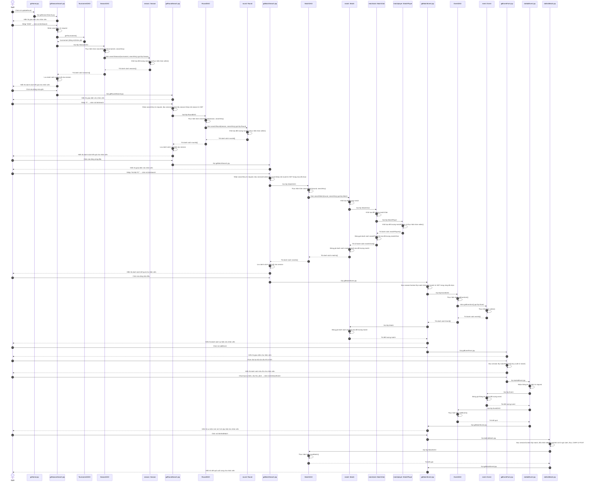

# PHA THIẾT KẾ — CHỨC NĂNG 3: CẬP NHẬT KẾT QUẢ TRẬN ĐẤU

Kiến trúc: **JSP – DAO**, không Controller. Java + JSP + PostgreSQL (JDBC).

> **Trạng thái: ĐÃ HIỆN THỰC CN3.** Staff đi từ trang chủ qua tìm mùa → vòng → trận đến `gdMatchEvent.jsp`/`gdEventForm.jsp`; POST `doAddEvent.jsp` gọi `EventDAO.addEvent(Match, Event)`, POST `doEndMatch.jsp` gọi `MatchDAO.saveMatch(Match)`. `EventDAO.getEventList(int)` trả `List<Event>` đúng subtype. Dùng JSP–DAO/PostgreSQL, session `currentUser`, không thêm Controller/Service. Chỉ thêm sự kiện và kết thúc, không sửa/xóa/mở lại trận.

> **Phạm vi dữ liệu demo 08/11/2026:** 1 Tournament, 5 Season, 14 CLB, 26 vòng/182 trận mùa chính. Cặp đấu/hồ sơ dựa nguồn VPF; lịch dịch quanh ngày seed, đội hình/diễn biến phục vụ demo không phải biên bản lịch sử đã xác minh. Nguồn/khác biệt lưu ngoài database, không metadata mô phỏng; mọi thẻ đều tính treo giò. CN3 không yêu cầu reset hoặc đổi schema. Ngày chưa xác định vẫn nullable.

> **Contract mô hình cập nhật 10/11/2026:** giữ `seasons.name`, đồ thị một chiều và kế thừa Event; `Round.number` lưu tại `rounds.number`, độc lập tên. UI giữ mã đầy đủ `R07-T01`, dùng số vòng và thứ tự ID trận trong toàn vòng trước khi lọc. Điều hướng CN2/CN3 dùng chung `SessionContext` (session key `sessionContext`), thay `LineupSession`, không thêm model/service. GET dùng `index.jsp?page=match-event&season=VLE2026&round=R07&match=T01`, phân giải mã từ kết quả đã tải trong session, không dùng `mode=events` trên GET; đổi chức năng hoặc mùa/vòng/trận vô hiệu hóa ngữ cảnh cũ. POST giữ hidden ID thật, flow và CSRF; khóa chính/FK CSDL không đổi.

> Danh tính đăng nhập kế thừa CN1 là session `currentUser: User` qua `UserDAO`, không phải session `staff`, không đổi khi dùng `sessionContext`. Mã trên GET chỉ chọn đối tượng từ kết quả đã tải trong ngữ cảnh session; hidden ID trên POST phải khớp ngữ cảnh, không tạo đối tượng tin cậy trực tiếp từ request.

> **Quy tắc cài đặt:** chỉ nhận SCHEDULED/ONGOING với hai đội hình đủ 11 chính/có thủ môn và quota hợp lệ; sự kiện đầu tiên chuyển ONGOING, kết thúc chuyển FINISHED (0–0 hợp lệ). Không thêm action bắt đầu hoặc giới hạn kickoff chưa được báo cáo quy định. Phút/bù giờ là số nguyên không âm, ghi chú tối đa255 ký tự. Replay toàn bộ timeline theo phút/bù giờ/ID để chặn actor đã ra sân/thẻ đỏ, cầu thủ dự bị chưa vào, thay người quá Rule.maxSubstitutions hoặc vào lại. Hai vàng không tự sinh đỏ. Thêm lùi thời điểm không được làm sai sự kiện phía sau.
>
> **Giao dịch và bảo mật:** match row FOR UPDATE dùng chung với CN2, kiểm tra đăng ký hiện tại trong DB, ghi Event+subtype nguyên tử; FINISHED bị chặn tại DAO và POST, không chỉ UI. ID/cache chỉ đổi sau commit; tỷ số lấy `v_match_scores`, OWN cộng đối phương. `EventDAO.refreshMatch(Match)` đọc status/tỷ số mới nhất mà không tải lại đội hình. POST yêu cầu Staff/currentUser, CSRF, flow và đầy đủ ID ngữ cảnh; lỗi giữ lựa chọn, PRG và escape HTML.

---

## 1. THIẾT KẾ TĨNH — FULL VIEW CLASS DIAGRAM

### 1.1. Tầng giao diện gồm các trang .jsp

**Giao diện tìm mùa giải: gdSeasonSearch.jsp**
- Thuộc tính tường minh:
  - searchKey: input
  - btnSearch: submit
  - tblSeason: Table
  - chooseSeason: link
- Thuộc tính ẩn:
  - currentUser: User
  - listSeason: Season[]
  - tournament: Tournament (từ TournamentDAO.getTournament(), duy nhất một bản ghi)
- Submit về chính trang này (action: self): nhận searchKey từ param, gọi SeasonDAO thực hiện searchSeason(tournament, searchKey).

**Giao diện tìm vòng đấu: gdRoundSearch.jsp**
- Thuộc tính tường minh:
  - searchKey: input
  - btnSearch: submit
  - tblRound: Table
  - chooseRound: link
- Thuộc tính ẩn:
  - currentUser: User
  - season: Season (đọc sessionContext, khớp mã season từ GET với kết quả mùa đã tải)
  - listRound: Round[]
- Submit về chính trang này (action: self): nhận searchKey từ param + đọc session lấy season, gọi RoundDAO thực hiện searchRound(season, key).

**Giao diện tìm trận đấu: gdMatchSearch.jsp**
- Thuộc tính tường minh:
  - searchKey: input
  - btnSearch: submit
  - tblMatch: Table
  - chooseMatch: link
- Thuộc tính ẩn:
  - currentUser: User
  - round: Round (đọc sessionContext, khớp mã round từ GET trong mùa đã chọn)
  - listMatch: Match[]
- Submit về chính trang này (action: self): nhận searchKey từ param + đọc session lấy round, gọi MatchDAO thực hiện searchMatch(round, key) — hàm tải trọn chuỗi ◆ (MatchPlayer → MatchClub → Match), lưu listMatch vào session.

**Giao diện sự kiện trận: gdMatchEvent.jsp**
- Thuộc tính tường minh:
  - lblMatchTime: label
  - lblHomeScore: label
  - lblAwayScore: label
  - tblEvent: Table
  - addEvent: link
  - btnEndMatch: submit
- Thuộc tính ẩn:
  - currentUser: User
  - match: Match (đọc sessionContext, khớp mã match từ GET trong vòng đã chọn — đã chứa đầy đủ matchClubs + matchPlayers từ searchMatch)
  - listEvent: Event[]
  - listPlayerHome: MatchPlayer[] (truy xuất từ match, lưu vào session cho gdEventForm)
  - listPlayerAway: MatchPlayer[] (truy xuất từ match, lưu vào session cho gdEventForm)
- Đọc session lấy match → gọi EventDAO thực hiện getEventList(matchId) → lấy danh sách cầu thủ 2 CLB từ match lưu vào session → hiển thị tỉ số + danh sách sự kiện. KHÔNG gọi DAO lấy đội hình — đã có sẵn trong match.

**Giao diện thêm sự kiện: gdEventForm.jsp**
- Thuộc tính tường minh:
  - club: select
  - eventType: select
  - matchMinute: input
  - stoppageMinute: input
  - primaryPlayer: select
  - secondaryPlayer: select
  - note: input
  - btnSaveEvent: submit
- Thuộc tính ẩn:
  - currentUser: User
  - match: Match (đọc session)
  - listPlayerHome: MatchPlayer[] (đọc session — đã lưu từ gdMatchEvent)
  - listPlayerAway: MatchPlayer[] (đọc session — đã lưu từ gdMatchEvent)
- Nhận matchClubId từ param khi nhân viên chọn CLB → đọc session lấy danh sách cầu thủ CLB đã chọn (KHÔNG gọi CSDL — dữ liệu đã cached). Submit form tới doAddEvent.jsp (action).

### 1.2. Tầng thao tác dữ liệu có các lớp DAO

**TournamentDAO:**
- Phương thức getTournament(): Tournament — CSDL phải có đúng một Tournament; không có hoặc nhiều hơn một là lỗi cấu hình, không chọn tùy ý bản ghi đầu.

**SeasonDAO:**
- Phương thức searchSeason(tournament: Tournament, key: String): Season[]

**RoundDAO:**
- Phương thức searchRound(season: Season, key: String): Round[]

**MatchDAO (DAO của chủ thể Match — thao tác trên trung gian MatchClub/MatchPlayer):**
- Phương thức searchMatch(round: Round, key: String): Match[] — tải trọn chuỗi ◆: MatchPlayer → MatchClub → Match
- Phương thức saveMatch(match: Match): boolean — lưu trạng thái kết thúc trận

**EventDAO (Event là lớp độc lập có DAO riêng — không phải trung gian):**
- Phương thức getEventList(matchId: int): Event[]
- Phương thức addEvent(match: Match, event: Event): boolean — tự cập nhật tỉ số trận

> **Quy tắc trung gian:** MatchClub, MatchPlayer là lớp trung gian ◆ sinh từ quan hệ n–n — KHÔNG có DAO riêng, thao tác qua MatchDAO. Event là lớp độc lập (con của Match nhưng không phải trung gian n–n) → có DAO riêng bình thường. Đội hình cầu thủ tải 1 lần duy nhất trong searchMatch, các trang sau đọc từ match trong session.

### 1.3. Tầng thực thể

Gồm tất cả các thực thể liên quan (xem biểu đồ).

### 1.4. Biểu đồ Full View

```mermaid
classDiagram
    direction LR

    class StaffActor["Staff"]
    class gdLogin {
        <<jsp gd>>
        +username: input
        +password: input
        +btnLogin: submit
        +action: doLogin.jsp
    }
    class doLogin {
        <<jsp do>>
        +user: User
        +call UserDAO: checkLogin
    }
    class gdHome {
        <<jsp gd>>
        +currentUser: User
        +managePlayer: link
        +registerLineup: link
        +updateResult: link
    }
    class gdSeasonSearch {
        <<jsp gd>>
        +currentUser: User
        +searchKey: input
        +btnSearch: submit
        +action: gdSeasonSearch.jsp
        +listSeason: Season[]
        +tournament: Tournament
        +tblSeason: Table
        +chooseSeason: link
    }
    class gdRoundSearch {
        <<jsp gd>>
        +currentUser: User
        +season: Season
        +searchKey: input
        +btnSearch: submit
        +action: gdRoundSearch.jsp
        +listRound: Round[]
        +tblRound: Table
        +chooseRound: link
    }
    class gdMatchSearch {
        <<jsp gd>>
        +currentUser: User
        +round: Round
        +searchKey: input
        +btnSearch: submit
        +action: gdMatchSearch.jsp
        +listMatch: Match[]
        +tblMatch: Table
        +chooseMatch: link
    }
    class gdMatchEvent {
        <<jsp gd>>
        +currentUser: User
        +match: Match
        +lblMatchTime: label
        +lblHomeScore: label
        +lblAwayScore: label
        +listEvent: Event[]
        +tblEvent: Table
        +addEvent: link
        +btnEndMatch: submit
        +action: doEndMatch.jsp
    }
    class gdEventForm {
        <<jsp gd>>
        +currentUser: User
        +match: Match
        +club: select
        +eventType: select
        +matchMinute: input
        +stoppageMinute: input
        +primaryPlayer: select
        +secondaryPlayer: select
        +note: input
        +btnSaveEvent: submit
        +action: doAddEvent.jsp
        +listPlayerHome: MatchPlayer[]
        +listPlayerAway: MatchPlayer[]
    }
    class doAddEvent {
        <<jsp do>>
        +event: Event
        +match: Match
        +call EventDAO: addEvent
    }
    class doEndMatch {
        <<jsp do>>
        +match: Match
        +call MatchDAO: saveMatch
    }

    class DAO {
        <<abstract>>
        +DAO()
        #con: Connection
    }
    class UserDAO {
        +UserDAO()
        +checkLogin(user: User): User
    }
    class TournamentDAO {
        +TournamentDAO()
        +getTournament(): Tournament
    }
    DAO <|-- TournamentDAO
    class SeasonDAO {
        +SeasonDAO()
        +searchSeason(tournament: Tournament, key: String): Season[]
    }
    class RoundDAO {
        +RoundDAO()
        +searchRound(season: Season, key: String): Round[]
    }
    class MatchDAO {
        +MatchDAO()
        +searchMatch(round: Round, key: String): Match[]
        +saveMatch(match: Match): boolean
    }
    class EventDAO {
        +EventDAO()
        +getEventList(matchId: int): Event[]
        +addEvent(match: Match, event: Event): boolean
    }
    DAO <|-- UserDAO
    DAO <|-- SeasonDAO
    DAO <|-- RoundDAO
    DAO <|-- MatchDAO
    DAO <|-- EventDAO

    class User {
        +id: int
        +username: String
        +password: String
        +fullName: String
        +dob: LocalDate
        +email: String
        +phone: String
    }
    class Staff {
        +position: String
    }
    class Manager {
    }
    class Player {
        +nationality: String
        +primaryPosition: String
        +heightCm: double
        +weightKg: double
    }
    class Tournament {
        +id: int
        +name: String
        +seasons: Season[]
    }
    class Season {
        +id: int
        +year: int
        +name: String
        +startDate: LocalDate
        +endDate: LocalDate
        +status: String
        +rule: Rule
        +rounds: Round[]
    }
    class Rule {
        +id: int
        +requiredMainPlayers: int
        +maxBenchPlayers: int
        +maxSubstitutions: int
        +yellowCardsToSuspend: int
        +ageLimit: int
        +maxForeignPlayers: int
    }
    class Round {
        +id: int
        +number: int
        +name: String
        +startTime: LocalDateTime
        +endTime: LocalDateTime
        +status: String
        +matches: Match[]
    }
    class Match {
        +id: int
        +kickoffTime: LocalDateTime
        +status: String
        +matchClubs: MatchClub[]
        +events: Event[]
    }
    class MatchClub {
        +id: int
        +role: String
        +score: int
        +club: Club
        +matchPlayers: MatchPlayer[]
    }
    class ClubPlayer {
        +id: int
        +shirtNumber: int
        +player: Player
    }
    class MatchPlayer {
        +id: int
        +registeredAt: LocalDateTime
        +role: String
        +clubPlayer: ClubPlayer
    }
    class Event {
        <<abstract>>
        +id: int
        +minute: int
        +extraMinute: int
        +note: String
        +primaryPlayer: MatchPlayer
    }
    class Goal {
        +type: String
        +assister: MatchPlayer
    }
    class Foul {
        +victim: MatchPlayer
    }
    class YellowCard {
    }
    class RedCard {
    }
    class Substitution {
        +playerIn: MatchPlayer
    }
    class Club {
        +id: int
        +fullName: String
        +shortName: String
        +foundingYear: int
        +coachName: String
        +manager: Manager
        +homeStadium: Stadium
        +clubPlayers: ClubPlayer[]
    }
    class Stadium {
        +id: int
        +name: String
        +capacity: int
        +address: String
    }

    User <|-- Staff
    User <|-- Manager
    User <|-- Player
    Event <|-- Goal
    Event <|-- Foul
    Event <|-- YellowCard
    Event <|-- RedCard
    Event <|-- Substitution
    Tournament "1" *-- "1..*" Season
    Season "0..*" o-- "1" Rule
    Season "1" *-- "1..*" Round
    Round "1" *-- "1..*" Match
    Match "1" *-- "0..*" Event
    Club "1" o-- "1" Manager : managed by
    Club "0..*" o-- "1" Stadium : home stadium
    Match "1" *-- "2" MatchClub
    MatchClub "0..*" o-- "1" Club
    Club "1" *-- "0..*" ClubPlayer
    ClubPlayer "0..*" o-- "1" Player
    MatchClub "1" *-- "0..*" MatchPlayer
    MatchPlayer "0..*" o-- "1" ClubPlayer
    Event "0..*" o-- "1" MatchPlayer : primary
    Goal "0..*" o-- "0..1" MatchPlayer : assister
    Foul "0..*" o-- "1" MatchPlayer : victim
    Substitution "0..1" o-- "1" MatchPlayer : player in

    StaffActor --> gdLogin
    gdLogin --> doLogin : submit [btnLogin]
    doLogin --> gdHome : redirect
    gdHome --> gdSeasonSearch : link [updateResult]
    gdSeasonSearch --> gdSeasonSearch : submit [btnSearch]
    gdSeasonSearch --> gdRoundSearch : link [chooseSeason]
    gdRoundSearch --> gdRoundSearch : submit [btnSearch]
    gdRoundSearch --> gdMatchSearch : link [chooseRound]
    gdMatchSearch --> gdMatchSearch : submit [btnSearch]
    gdMatchSearch --> gdMatchEvent : link [chooseMatch]
    gdMatchEvent --> gdEventForm : link [addEvent]
    gdEventForm --> doAddEvent : submit [btnSaveEvent]
    doAddEvent --> gdMatchEvent : redirect
    gdMatchEvent --> doEndMatch : submit [btnEndMatch]
    doEndMatch --> gdMatchEvent : redirect

    doLogin ..> UserDAO : checkLogin
    gdSeasonSearch ..> TournamentDAO : getTournament()
    gdSeasonSearch ..> SeasonDAO : searchSeason
    gdRoundSearch ..> RoundDAO : searchRound
    gdMatchSearch ..> MatchDAO : searchMatch
    gdMatchEvent ..> EventDAO : getEventList
    doAddEvent ..> EventDAO : addEvent
    doEndMatch ..> MatchDAO : saveMatch
```

---

## 2. MÔ TẢ ACTIVITY DIAGRAM

**Các activity đại diện cho các lớp giao diện, kèm các action của giao diện**

**gdHome.jsp**
- Nhận currentUser từ session
- Hiện giao diện (menu)
- Nhân viên click nút updateResult → chuyển gdSeasonSearch.jsp

**gdSeasonSearch.jsp / gdRoundSearch.jsp / gdMatchSearch.jsp**
- (giống Chức năng 2)

**gdMatchEvent.jsp**
- Đọc sessionContext lấy đối tượng match khớp mã match từ GET trong vòng đã chọn
- Gọi EventDAO thực hiện getEventList() — lấy danh sách sự kiện của trận đấu
- Hiện tỉ số và danh sách sự kiện cho nhân viên
- Nhân viên click nút addEvent → chuyển gdEventForm.jsp
- Nhân viên click nút btnEndMatch → chuyển doEndMatch.jsp
- Nhận lại từ doAddEvent.jsp / doEndMatch.jsp → hiện sự kiện mới + tỉ số cập nhật / kết quả cuối cùng

**gdEventForm.jsp**
- Hiện giao diện (form sự kiện: loại sự kiện, câu lạc bộ, phút)
- Nhận matchClubId từ param khi nhân viên chọn câu lạc bộ
- Đọc session lấy danh sách cầu thủ của CLB đã chọn
- Hiện danh sách cầu thủ cho nhân viên
- Nhận loại sự kiện, cầu thủ, phút nhân viên nhập vào, click nút btnSaveEvent → chuyển doAddEvent.jsp

**doAddEvent.jsp**
- Nhận thông tin sự kiện từ request
- Gọi lớp Event đóng gói thành đối tượng Event
- Gọi EventDAO thực hiện addEvent() — tự cập nhật tỉ số trận
- Chuyển về gdMatchEvent.jsp
- Hiển thị sự kiện mới và tỉ số cập nhật nếu thành công / thông báo lỗi nếu không thành công

**doEndMatch.jsp**
- Đọc sessionContext lấy đối tượng match, đối chiếu hidden matchId/ID ngữ cảnh, flow và CSRF từ POST
- Gọi MatchDAO thực hiện saveMatch() — lưu trạng thái kết thúc trận
- Chuyển về gdMatchEvent.jsp (khóa khung, không cho thêm sự kiện nữa)
- Hiển thị kết quả cuối cùng của trận đấu

---

---

## 3. THIẾT KẾ ĐỘNG

### 3.1. Kịch bản

| Bước | Nội dung thao tác |
|---|---|
| 1 | Nhân viên BTC click nút updateResult |
| 2 | gdHome.jsp gọi gdSeasonSearch.jsp |
| 3 | gdSeasonSearch.jsp hiển thị giao diện cho nhân viên |
| 4 | Nhân viên BTC nhập "2026", click nút btnSearch |
| 5 | gdSeasonSearch.jsp nhận searchKey từ request |
| 6 | gdSeasonSearch.jsp gọi TournamentDAO.getTournament(), giữ tournament trong ngữ cảnh rồi gọi SeasonDAO |
| 7 | SeasonDAO thực hiện hàm searchSeason(tournament, searchKey) |
| 8 | Hàm searchSeason(tournament, searchKey) thực hiện và gọi lớp Season |
| 9 | Lớp Season khởi tạo đối tượng season và thực hiện hàm setter() |
| 10 | Lớp Season trả danh sách seasons[] cho hàm searchSeason(tournament, searchKey) |
| 11 | Hàm searchSeason(tournament, searchKey) trả danh sách seasons[] cho gdSeasonSearch.jsp |
| 12 | gdSeasonSearch.jsp lưu danh sách seasons[] vào session |
| 13 | gdSeasonSearch.jsp hiển thị danh sách kết quả cho nhân viên. |
| 14 | Nhân viên BTC click vào dòng mùa giải |
| 15 | gdSeasonSearch.jsp gọi gdRoundSearch.jsp |
| 16 | gdRoundSearch.jsp hiển thị giao diện cho nhân viên |
| 17 | Nhân viên BTC nhập "5", click nút btnSearch |
| 18 | gdRoundSearch.jsp nhận searchKey từ request, đọc sessionContext lấy đối tượng season khớp mã season từ GET |
| 19 | gdRoundSearch.jsp gọi lớp RoundDAO |
| 20 | RoundDAO thực hiện hàm searchRound(season, searchKey) |
| 21 | Hàm searchRound(season, searchKey) thực hiện và gọi lớp Round |
| 22 | Lớp Round khởi tạo đối tượng round và thực hiện hàm setter() |
| 23 | Lớp Round trả danh sách rounds[] cho hàm searchRound(season, searchKey) |
| 24 | Hàm searchRound(season, searchKey) trả danh sách rounds[] cho gdRoundSearch.jsp |
| 25 | gdRoundSearch.jsp lưu danh sách rounds[] vào session |
| 26 | gdRoundSearch.jsp hiển thị danh sách kết quả cho nhân viên |
| 27 | Nhân viên BTC click vào dòng vòng đấu |
| 28 | gdRoundSearch.jsp gọi gdMatchSearch.jsp |
| 29 | gdMatchSearch.jsp hiển thị giao diện cho nhân viên |
| 30 | Nhân viên BTC nhập "Hà Nội FC", click nút btnSearch |
| 31 | gdMatchSearch.jsp nhận searchKey từ request, đọc sessionContext lấy đối tượng round khớp mã round từ GET trong mùa đã chọn |
| 32 | gdMatchSearch.jsp gọi lớp MatchDAO |
| 33 | MatchDAO thực hiện hàm searchMatch(round, searchKey) |
| 34 | Hàm searchMatch(round, searchKey) thực hiện và gọi lớp Match |
| 35 | Lớp Match khởi tạo đối tượng match |
| 36 | Lớp Match gọi lớp MatchClub |
| 37 | Lớp MatchClub khởi tạo đối tượng matchClub |
| 38 | Lớp MatchClub gọi lớp MatchPlayer |
| 39 | Lớp MatchPlayer khởi tạo đối tượng matchPlayer và thực hiện hàm setter() |
| 40 | Lớp MatchPlayer trả danh sách matchPlayers[] cho lớp MatchClub |
| 41 | Lớp MatchClub đóng gói danh sách matchPlayers[] vào đối tượng matchClub |
| 42 | Lớp MatchClub trả về danh sách matchClubs[] cho lớp Match |
| 43 | Lớp Match đóng gói danh sách matchClubs[] vào đối tượng match |
| 44 | Lớp Match trả danh sách matchs[] cho hàm searchMatch(round, searchKey) |
| 45 | Hàm searchMatch(round, searchKey) trả danh sách matchs[] cho gdMatchSearch.jsp |
| 46 | gdMatchSearch.jsp lưu danh sách matchs[] vào session |
| 47 | gdMatchSearch.jsp hiển thị danh sách kết quả cho nhân viên |
| 48 | Nhân viên BTC click vào dòng trận đấu |
| 49 | gdMatchSearch.jsp gọi gdMatchEvent.jsp |
| 50 | gdMatchEvent.jsp đọc sessionContext lấy đối tượng match khớp mã match từ GET trong vòng đã chọn |
| 51 | gdMatchEvent.jsp gọi lớp EventDAO |
| 52 | EventDAO thực hiện hàm getEventList() |
| 53 | Hàm getEventList() thực hiện và gọi lớp Event |
| 54 | Lớp Event thực hiện hàm setter() |
| 55 | Lớp Event trả danh sách events[] cho hàm getEventList() |
| 56 | Hàm getEventList() trả danh sách Event[] cho gdMatchEvent.jsp |
| 57 | gdMatchEvent.jsp gọi lớp Match |
| 58 | Lớp Match đóng gói danh sách events[] vào đối tượng match |
| 59 | Lớp Match trả đối tượng match cho gdMatchEvent.jsp |
| 60 | gdMatchEvent.jsp hiển thị danh sách sự kiện cho nhân viên |
| 61 | Nhân viên BTC click nút addEvent |
| 62 | gdMatchEvent.jsp gọi gdEventForm.jsp |
| 63 | gdEventForm.jsp hiển thị giao diện cho nhân viên |
| 64 | Nhân viên BTC chọn câu lạc bộ của cầu thủ chính của sự kiện |
| 65 | gdEventForm.jsp đọc session lấy matchPlayers[] (truy xuất từ match) |
| 66 | gdEventForm.jsp hiển thị danh sách cầu thủ cho nhân viên |
| 67 | Nhân viên BTC chọn loại sự kiện, cầu thủ, phút, click nút btnSaveEvent |
| 68 | gdEventForm.jsp gọi doAddEvent.jsp |
| 69 | doAddEvent.jsp nhận thông tin sự kiện từ request |
| 70 | doAddEvent.jsp gọi lớp Event |
| 71 | Lớp Event đóng gói thông tin thành đối tượng event |
| 72 | Lớp Event trả đối tượng event cho doAddEvent.jsp |
| 73 | doAddEvent.jsp gọi lớp EventDAO |
| 74 | EventDAO thực hiện hàm addEvent() |
| 75 | Hàm addEvent() trả kết quả cho doAddEvent.jsp |
| 76 | doAddEvent.jsp gọi gdMatchEvent.jsp |
| 77 | gdMatchEvent.jsp hiển thị sự kiện mới và tỉ số cập nhật cho nhân viên |
| 78 | Nhân viên BTC click nút btnEndMatch |
| 79 | gdMatchEvent.jsp gọi doEndMatch.jsp |
| 80 | doEndMatch.jsp đọc sessionContext lấy đối tượng match, đối chiếu hidden matchId/ID ngữ cảnh, flow và CSRF từ POST |
| 81 | doEndMatch.jsp gọi lớp MatchDAO |
| 82 | MatchDAO thực hiện hàm saveMatch() |
| 83 | Hàm saveMatch() trả kết quả cho doEndMatch.jsp |
| 84 | doEndMatch.jsp gọi gdMatchEvent.jsp |
| 85 | gdMatchEvent.jsp hiển thị kết quả cuối cùng cho nhân viên. |

### 3.2. Sequence Diagram

