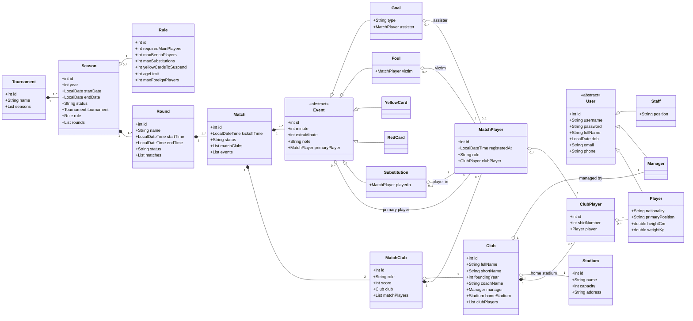
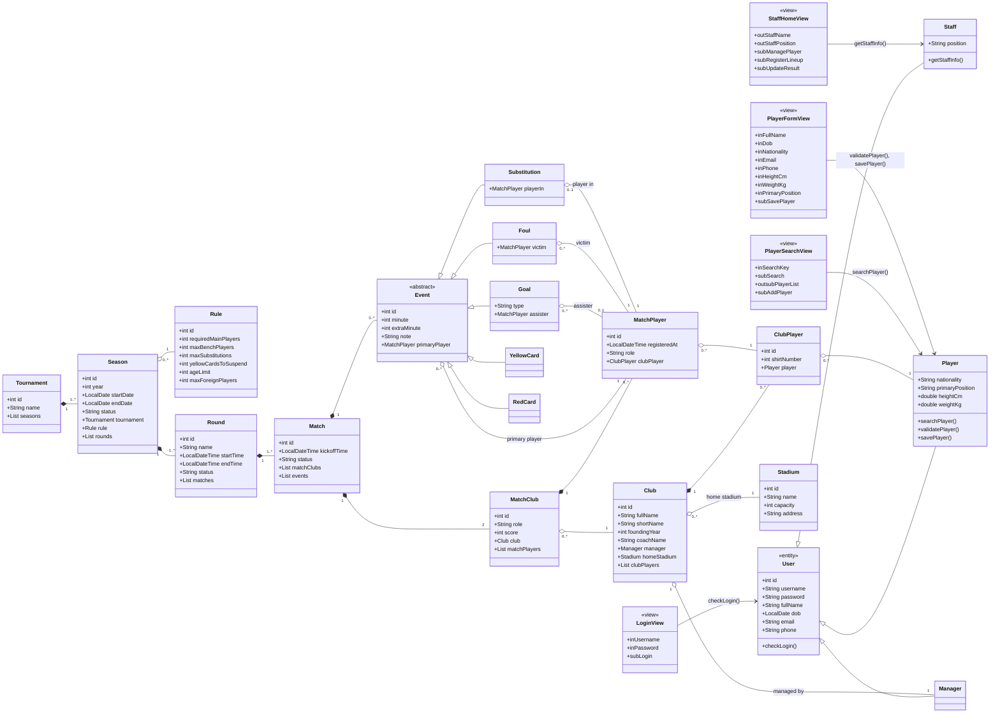

# PHASE B. ANALYSIS — CLASS DIAGRAM (BẢN CHỐT SAU CHẤM SỬA)

Hệ thống quản lí giải bóng đá vô địch quốc gia — Module M1

> **Kiến trúc triển khai (pha cài đặt):** Java — mô hình **JSP + DAO**, không dùng Controller: JSP (View) gọi thẳng DAO/Entity, đúng phương pháp Full View ở mục 5 (View gọi entity không qua lớp trung gian điều khiển).

> **Các quy tắc mô hình hóa đã chốt với giảng viên:**
> 1. Quan hệ có bội số > 1 ở cả hai đầu (n–n, 2–n) → **bắt buộc tách lớp trung gian**. Không dùng nhiều đường nối đặt vai trò cho cùng một cặp lớp.
> 2. **Quan hệ gián tiếp qua chuỗi thì KHÔNG lập quan hệ trực tiếp** (Club không nối Season — đã gián tiếp qua Match: Club → MatchClub → Match → Round → Season).
> 3. **Lớp phải là số ít** ("danh sách" không phải lớp — tập instance lấy qua quan hệ; không có thuộc tính kiểu danh sách).
> 4. Hai đường nối giữa cùng một cặp lớp chỉ hợp lệ khi là **hai quan hệ nghiệp vụ khác nhau** (động từ khác nhau: rời sân / vào sân) — không được dùng để mã hóa số lượng (đúng/etc sai như home/away).
> 5. Sự kiện phân tách theo **lớp kế thừa** (Goal, Foul, Substitution...) thay vì thuộc tính type; mỗi lớp con tự khai báo quan hệ cầu thủ của nó với tên nghiệp vụ.
> 6. Lớp trung gian sinh từ quan hệ n–n **không được thao tác độc lập**: phương thức đọc/ghi trên trung gian đặt ở **lớp chủ thể** (whole ◆) mà nó gắn chặt vào, đẩy chuỗi lên chủ thể cao nhất không phải trung gian — thao tác MatchPlayer/MatchClub → `Match`; thao tác ClubPlayer → `Club`. Đầu vào hàm là **đối tượng chủ thể**, đầu ra giữ nguyên dữ liệu cần trả.

---

## 1. Danh sách Entity Class (20 class)

> **Quy ước thuộc tính (chuẩn PHP 8):**
> - Mọi lớp **không kế thừa** có `+int id` (khóa); lớp kế thừa dùng id kế thừa (Staff/Manager/Player từ `User`; Goal/Foul/... từ `Event`).
> - Kiểu dữ liệu **Java** (ngôn ngữ triển khai pha cài đặt): `int`, `String`, `double`, `LocalDate`/`LocalDateTime`; số nhiều dùng `List<T>`. Các thuộc tính phân loại (status của Match, role của MatchClub/MatchPlayer, type của Goal) dùng `String` nhận giá trị hằng.
> - **Thuộc tính đối tượng**: giữa hai lớp có quan hệ aggregation/composition, **lớp chứa khai báo tường minh thuộc tính có kiểu là lớp bị chứa** — bội số 1 → kiểu đơn (`Club club`), 0..1 → tham chiếu có thể null (`MatchPlayer assister` — assister của Goal), n → `List<T>` (`List<MatchPlayer> matchPlayers`).

### 1.1. Người dùng & con người (4)

| Class | Thuộc tính | Thuộc tính đối tượng | Ghi chú |
|---|---|---|---|
| `User` «abstract» | `+int id`, `+String username`, `+String password`, `+String fullName`, `+LocalDate dob`, `+String email`, `+String phone` | — | Lớp cha của 3 loại người dùng đều đăng nhập |
| `Staff` | `+String position` | — | Kế thừa `User` (dùng `id` kế thừa) |
| `Manager` | — | — | Kế thừa `User` |
| `Player` | `+String nationality`, `+String primaryPosition`, `+double heightCm`, `+double weightKg` | — | Kế thừa `User`; tạo Player đồng thời tạo tài khoản |

### 1.2. Tổ chức & giải đấu (7)

| Class | Thuộc tính | Thuộc tính đối tượng | Ghi chú |
|---|---|---|---|
| `Tournament` | `+int id`, `+String name` | `+List<Season> seasons` | Giải đấu (vd "Giải bóng đá vô địch quốc gia") — hiện chỉ 1 bản ghi nhưng là đơn vị tổ chức: tên giải lưu MỘT lần, không lặp theo mùa; tên hiển thị của mùa = `tournament.name + year` (derived) |
| `Season` | `+int id`, `+int year`, `+LocalDate startDate`, `+LocalDate endDate`, `+String status` | `+Tournament tournament`, `+Rule rule`, `+List<Round> rounds` | Mùa giải (vd V.League 2026) — thuộc đúng một giải đấu |
| `Rule` | `+int id`, `+int requiredMainPlayers`, `+int maxBenchPlayers`, `+int maxSubstitutions`, `+int yellowCardsToSuspend`, `+int ageLimit`, `+int maxForeignPlayers` | — | Điều lệ giải — kiểm tra đội hình (UC2), tính treo giò (UC3) |
| `Round` | `+int id`, `+String name`, `+LocalDateTime startTime`, `+LocalDateTime endTime`, `+String status` | `+List<Match> matches` | |
| `Match` | `+int id`, `+LocalDateTime kickoffTime`, `+String status` | `+List<MatchClub> matchClubs`, `+List<Event> events` | Tỉ số nằm ở `MatchClub` (mỗi bên một tỉ số) |
| `Club` | `+int id`, `+String fullName`, `+String shortName`, `+int foundingYear`, `+String coachName` | `+Manager manager`, `+Stadium homeStadium`, `+List<ClubPlayer> clubPlayers` | `coachName` chỉ hiển thị — HLV không phải actor |
| `Stadium` | `+int id`, `+String name`, `+int capacity`, `+String address` | — | |

### 1.3. Lớp trung gian — chuỗi xương sống (3)

| Class | Thuộc tính | Thuộc tính đối tượng | Nghĩa |
|---|---|---|---|
| `MatchClub` | `+int id`, `+String role`, `+int score` (derived) | `+Club club`, `+List<MatchPlayer> matchPlayers` | một CLB tham gia một trận với vai trò đội nhà/đội khách |
| `ClubPlayer` | `+int id`, `+int shirtNumber` | `+Player player` | một cầu thủ thuộc một CLB (số áo) |
| `MatchPlayer` | `+int id`, `+LocalDateTime registeredAt`, `+String role` | `+ClubPlayer clubPlayer` | một cầu thủ của CLB được đăng kí thi đấu một trận (đá chính/dự bị) — registeredAt = thời điểm đăng kí |

### 1.4. Sự kiện (6)

| Class | Thuộc tính | Thuộc tính đối tượng | Ghi chú |
|---|---|---|---|
| `Event` «abstract» | `+int id`, `+int minute`, `+int extraMinute`, `+String note` | `+MatchPlayer primaryPlayer` | Cha của mọi loại sự kiện — giữ quan hệ **cầu thủ chính** (aggregation) chung cho mọi loại |
| `Goal` | `+String type` | `+MatchPlayer assister` | gộp 3 loại bàn thắng (thường, phạt đền, phản lưới); assister nullable — chỉ Goal thường có kiến tạo |
| `Foul` | — | `+MatchPlayer victim` | quan hệ riêng **victim** (người bị phạm lỗi) |
| `YellowCard` | — | — | chỉ cầu thủ chính (người nhận thẻ) |
| `RedCard` | — | — | chỉ cầu thủ chính (người nhận thẻ) |
| `Substitution` | — | `+MatchPlayer playerIn` | quan hệ riêng **player in** (cầu thủ vào sân); cầu thủ ra sân = cầu thủ chính |

### 1.5. Giá trị chuỗi quy ước (các thuộc tính String phân loại)

| Thuộc tính | Giá trị nhận |
|---|---|
| `Match.status` | SCHEDULED, ONGOING, FINISHED |
| `MatchClub.role` | HOME, AWAY |
| `MatchPlayer.role` | STARTING, SUBSTITUTE |
| `Goal.type` | NORMAL, PENALTY, OWN |

---

## 2. Quan hệ giữa các thực thể

**Quy ước ◆/◇:** hình thoi nằm ở lớp **chứa** (whole). Test: xóa whole → part mất theo = **◆ composition** (vòng đời gắn liền); part vẫn tồn tại = **◇ aggregation** (tham chiếu).

**Quy tắc chuyển quan hệ n–n thành chuỗi chứa đựng (quy định của giảng viên):** nếu A liên kết B sinh lớp trung gian C thì chỉ được chọn MỘT trong 3 dạng chuỗi: (i) A chứa C, C chứa B; (ii) B chứa C, C chứa A; (iii) C chứa cả A và B. **Không được để cả A và B cùng chứa C.** Mô hình này chọn thống nhất dạng (ii): lớp bối cảnh mạnh (Match, Club, MatchClub) chứa trung gian bằng ◆; trung gian chứa lớp tham chiếu còn lại bằng ◇ — đúng tư duy ngược từ code (trung gian giữ tham chiếu: `class MatchClub { Club club; ... }`).

**Quan hệ trực tiếp:**

| # | Quan hệ | Bội số | Loại | Ghi chú |
|---|---|---|---|---|
| 1 | Tournament – Season | 1 – 1..* | ◆ tại Tournament | một giải đấu có nhiều mùa giải (ít nhất 1); tên mùa hiển thị = tên giải + năm (derived) |
| 2 | Season – Rule | 0..* – 1 | ◇ tại Season | **1 Rule áp dụng cho nhiều mùa giải**; mỗi mùa dùng đúng 1 điều lệ — dùng chung nên xóa mùa, điều lệ vẫn còn |
| 3 | Season – Round | 1 – 1..* | ◆ tại Season | |
| 4 | Round – Match | 1 – 1..* | ◆ tại Round | |
| 5 | Match – Event | 1 – 0..* | ◆ tại Match | các lớp con kế thừa nên đều thuộc một trận |
| 6 | Stadium – Club | 1 – n | ◇ tại Club | sân nhà — xóa CLB → sân còn |
| 7 | Club – Manager | 1 – 1 | ◇ tại Club | "tại cùng một thời điểm" — Manager là `User` độc lập |

**Quan hệ qua lớp trung gian — dạng chuỗi chứa đựng (Match ⊃ MatchClub ↘ Club, v.v.):**

| # | Cạnh chứa mạnh (◆) | Cạnh chứa tham chiếu (◇) | Chuỗi |
|---|---|---|---|
| 7 | Match (1) ◆ (2) **MatchClub** | MatchClub (0..*) ◇ (1) **Club** | Match chứa MatchClub; MatchClub chứa Club — đội-trong-trận sống chết theo trận, giữ tham chiếu CLB; mỗi Match đúng 2 (1 HOME + 1 AWAY) |
| 8 | Club (1) ◆ (0..*) **ClubPlayer** | ClubPlayer (0..*) ◇ (1) **Player** | Club chứa ClubPlayer; ClubPlayer chứa Player — cầu thủ của CLB sống chết theo CLB, giữ tham chiếu cầu thủ |
| 9 | MatchClub (1) ◆ (0..*) **MatchPlayer** | MatchPlayer (0..*) ◇ (1) **ClubPlayer** | MatchClub chứa MatchPlayer; MatchPlayer chứa ClubPlayer — đăng kí thi đấu sống chết theo đội-trong-trận, giữ tham chiếu cầu thủ của CLB |

**Quan hệ sự kiện ↔ cầu thủ (MatchPlayer):**

| # | Quan hệ | Bội số | Kiểu | Nghĩa |
|---|---|---|---|---|
| 10 | Event – MatchPlayer | 0..* – 1 | ◇ tại Event | **cầu thủ chính** — mỗi sự kiện đúng 1 cầu thủ chính; một MatchPlayer là cầu thủ chính của nhiều sự kiện (ghi nhiều bàn, phạm nhiều lỗi...) — chung cho MỌI loại, đặt ở lớp cha |
| 11 | Goal – MatchPlayer | 0..* – 0..1 | ◇ tại Goal | **assister** — mỗi Goal tối đa 1 kiến tạo; một cầu thủ có thể kiến tạo nhiều bàn trong trận; chỉ áp dụng cho Goal thường (type = NORMAL) |
| 12 | Foul – MatchPlayer | 0..* – 1 | ◇ tại Foul | **victim** — mỗi Foul có 1 nạn nhân; một cầu thủ có thể bị phạm lỗi nhiều lần trong trận |
| 13 | Substitution – MatchPlayer | 0..1 – 1 | ◇ tại Substitution | **player in** — mỗi lần thay 1 cầu thủ vào; mỗi cầu thủ chỉ vào sân 1 lần trong trận (luật: ra rồi không vào lại) |
| — | YellowCard, RedCard | — | — | không có quan hệ riêng — chỉ dùng quan hệ cầu thủ chính của lớp cha (Goal phạt đền/phản lưới cũng vậy; kiến tạo chỉ dành cho Goal thường) |

Cả 4 quan hệ sự kiện là **aggregation**: xóa sự kiện → MatchPlayer vẫn tồn tại (cầu thủ vẫn trong đội hình trận).

**Kế thừa:** User ← Staff / Manager / Player; Event ← Goal, Foul, YellowCard, RedCard, Substitution.

**Đã bỏ / đã sửa so với bản cũ** (theo nhận xét chấm của giảng viên):
- ~~Season – Rule 1–1 ◆~~: sửa thành **◇ 0..\*–1** — 1 Rule áp dụng cho nhiều mùa giải, không còn "điều lệ riêng của mùa"
- ~~Tournament – Season 0..\*~~: đổi thành **1..\*** để nhất quán chuỗi tổ chức (giải ⇒ có mùa ⇒ có vòng ⇒ có trận); các quan hệ ghi nhận sau (Event, MatchPlayer, ClubPlayer) vẫn 0..\*
- ~~Club – Season → RegisteredClub~~: quan hệ gián tiếp qua Match (quy tắc 2) → xóa cả `RegisteredClub`, `RegisteredPlayer`
- ~~MatchClub – LineupRegistration~~, ~~LineupDetail, EventDetail~~: thay bằng `MatchPlayer` + lớp con sự kiện; không còn lớp phiếu (danh sách cầu thủ không lưu trong phiếu — quy tắc số ít)
- ~~EventType, EventRole enum~~: thay bằng kế thừa + tên quan hệ

**Ràng buộc nghiệp vụ:**
1. Mỗi Match đúng 2 MatchClub (1 HOME + 1 AWAY); **sân thi đấu derived**: `MatchClub(HOME) → Club → Stadium`
2. `MatchPlayer` chỉ hợp lệ khi `ClubPlayer.club == MatchClub.club` (cầu thủ đăng kí phải thuộc đúng CLB của đội-trong-trận)
3. Cầu thủ được lớp con sự kiện trỏ tới phải có `MatchPlayer` trong cùng trận
4. Đội hình hợp lệ theo `Rule` (đủ 11 STARTING, ≥1 thủ môn, ≤ ngoại binh, ≤ dự bị); **treo giò derived**: đếm thẻ YellowCard/RedCard → Match → Round → Season so với `yellowCardsToSuspend`
5. `/score` của MatchClub derived: Goal type NORMAL/PENALTY cộng bên scorer, type OWN cộng bên kia; xóa sự kiện tự trừ lại

---

## 3. Các quyết định phân tích (giải trình khi bảo vệ)

1. **Vì sao MatchClub phải tồn tại** — không phải để "thêm lớp cho đẹp" mà vì `MatchPlayer` cần neo vào đội-trong-trận; đồng thời tỉ số là của **mỗi bên**, không phải của trận.
2. **Vì sao Club không nối Season** — đã gián tiếp qua Match; thêm quan hệ trực tiếp là dư thừa (chính là lí do bị chấm sai ở bản trước).
3. **Vì sao tách lớp con sự kiện thay vì type + 2 đường nối generic** — 2 đường "cầu thủ chính/phụ" nghĩa thay đổi theo type nên là số lượng trá hình (cùng bản chất với home/away); tách lớp con cho mỗi quan hệ tên nghiệp vụ thật (scorer/assister, offender/victim, out/in) — cấu trúc tự loại tổ hợp sai (Foul không thể thiếu victim; kiến tạo chỉ có ở Goal thường — phân biệt bằng thuộc tính Goal.type). Riêng 3 loại bàn thắng gộp chung một lớp Goal với thuộc tính type vì cấu trúc quan hệ cầu thủ của chúng giống hệt nhau (cầu thủ chính qua lớp cha, kiến tạo tùy chọn) — chỉ khác cách tính tỉ số.
4. **Lớp số ít** — không có lớp "DanhSach..."; danh sách = tập instance qua quan hệ (bội số n).
5. **Tỉ số, sân, treo giò là derived** — không lưu cứng, suy ra từ quan hệ.
6. **Dạng chuỗi chứa đựng của lớp trung gian** — A liên kết B sinh C phải thành chuỗi (A chứa C, C chứa B / hoặc đảo / hoặc C chứa cả hai), không để cả hai cha cùng chứa con. Mô hình chọn: lớp bối cảnh mạnh chứa trung gian (◆ — Match ⊃ MatchClub, Club ⊃ ClubPlayer, MatchClub ⊃ MatchPlayer), trung gian chứa lớp tham chiếu còn lại (◇) — đúng `class MatchClub { Club club; }` khi code.
7. **Vì sao có lớp Tournament dù chỉ 1 bản ghi** — lớp tồn tại theo nghĩa nghiệp vụ (đơn vị tổ chức giải), không theo số dòng CSDL: (i) tên giải "Giải vô địch quốc gia" lưu MỘT lần thay vì lặp ở mọi mùa; (ii) tên hiển thị của mùa = tên giải + năm → derived; (iii) mở rộng sau này (Cúp QG, hạng nhất) không phải sửa cấu trúc.

---

## 4. Domain Model

---

## 5. Full View Class Diagram (mỗi chức năng một bản)

Phương pháp: **giữ nguyên biểu đồ lớp thực thể** (mục 4), copy cho mỗi chức năng, bổ sung:
- **Lớp View** «view»: mỗi giao diện trong scenario một lớp, bám sát scenario — không tự thêm giao diện.
- **Thuộc tính prefix**: `in` = nhập, `out` = hiện, `sub` = bắt sự kiện, `outsub` = vừa hiện vừa bấm vào được (bảng có bấm-chọn-dòng).
- **Method trên lớp thực thể** (chưa gắn kiểu dữ liệu); **lớp chủ thể** ưu tiên theo **đầu ra → đầu vào** — riêng phương thức thao tác trên **lớp trung gian** (MatchClub, ClubPlayer, MatchPlayer) đặt ở **lớp chủ thể** mà trung gian gắn chặt vào (quy tắc 6): thao tác MatchPlayer/MatchClub → `Match`, thao tác ClubPlayer → `Club`.

### 5.1. UC1 — Quản lí thông tin cầu thủ: **THÊM CẦU THỦ** (+ Đăng nhập)

**Diễn giải:**

**Giao diện "Đăng nhập" → `LoginView`**
- Nhập tên người dùng: `inUsername` · Nhập mật khẩu: `inPassword` · Nút "Đăng nhập": `subLogin`
- Cần phương thức `checkLogin()` — Đầu vào: username, password · Đầu ra: boolean · Chủ thể: `User`

**Giao diện chính của nhân viên BTC → `StaffHomeView`**
- Hiển thị tên: `outStaffName` · Hiển thị chức vụ: `outStaffPosition`
- Nút "Quản lý thông tin cầu thủ": `subManagePlayer` · Nút "Đăng ký cầu thủ thi đấu cho trận đấu": `subRegisterLineup` · Nút "Cập nhật kết quả thi đấu": `subUpdateResult`
- Cần phương thức `getStaffInfo()` — Đầu vào: Staff · Đầu ra: Staff · Chủ thể: `Staff`

**Giao diện "Tìm cầu thủ" → `PlayerSearchView`** (bước kiểm tra cầu thủ chưa có hồ sơ)
- Nhập từ khóa (tên hoặc mã): `inSearchKey` · Nút "Tìm": `subSearch` · Danh sách cầu thủ: `outsubPlayerList` · Nút "Thêm cầu thủ mới": `subAddPlayer`
- Cần phương thức `searchPlayer()` — Đầu vào: searchKey · Đầu ra: Player[] · Chủ thể: `Player`

**Giao diện "Thêm cầu thủ mới" → `PlayerFormView`**
- Nhập: `inFullName`, `inDob`, `inNationality`, `inEmail`, `inPhone`, `inHeightCm`, `inWeightKg`, `inPrimaryPosition` · Nút "Lưu thông tin cầu thủ": `subSavePlayer`
- Cần `validatePlayer()` — Player → boolean, `Player`; cần `savePlayer()` — Player → boolean, `Player` (pha thiết kế chuyển thành `PlayerDAO.addPlayer()`)

### 5.2. UC2 — Đăng ký cầu thủ thi đấu cho trận đấu

**Diễn giải:**

**`LoginView`, `StaffHomeView`** — như UC1.

**Giao diện "Tìm giải đấu" → `SeasonSearchView`**
- `inSearchKey`, `subSearch`, `outsubSeasonList`
- `searchSeason()` — searchKey → Season[] · `Season`

**Giao diện "Tìm vòng đấu" → `RoundSearchView`**
- `inSearchKey`, `subSearch`, `outsubRoundList`
- `searchRound()` — searchKey → Round[] · `Round`

**Giao diện "Tìm trận đấu" → `MatchSearchView`**
- `inSearchKey`, `subSearch`, `outsubMatchList`
- `searchMatch()` — searchKey → Match[] · `Match`

**Giao diện "Thông tin trận đấu" → `MatchInfoView`**
- Hiển thị thời gian: `outMatchTime` · sân: `outStadium` · danh sách đã đăng ký đội nhà/đội khách: `outHomeLineup`, `outAwayLineup`
- Nút "Đăng ký đội hình" đội nhà / đội khách: `subRegisterHomeLineup`, `subRegisterAwayLineup`
- `getMatchInfo()` — Match → Match · `Match` (tải chi tiết hiển thị: tên CLB, tỉ số — đội hình MatchPlayer[] đã có sẵn trong match từ searchMatch)

**Giao diện "Đăng ký danh sách thi đấu" → `LineupRegistrationView`**
- Danh sách cầu thủ của CLB: `outsubPlayerList` · chọn vai trò từng cầu thủ: `inRoleSelect` · Nút "Lưu danh sách đăng ký": `subSaveLineup`
- `getPlayerList()` — Club, season → ClubPlayer[] · `Club` (thao tác trên ClubPlayer trung gian → đặt ở chủ thể Club)
- `validateLineup()` — Match → boolean · `Match` (đọc ngưỡng từ `Rule`)
- `saveLineup()` — Match → boolean · `Match` (MatchPlayer đã được setter gắn vào MatchClub → Match)

Sơ đồ Mermaid: bản thực thể ở mục 4 + 6 View trên + các method vào đúng lớp + đường nối `SeasonSearchView → Season`, `RoundSearchView → Round`, `MatchSearchView → Match`, `MatchInfoView → Match` (getMatchInfo), `LineupRegistrationView → Match` (validateLineup, saveLineup), `LineupRegistrationView → Club` (getPlayerList).

### 5.3. UC3 — Cập nhật kết quả trận đấu

**Diễn giải (bản chốt):**

**Giao diện "Đăng nhập" → `LoginView`** (giống chức năng 1)
- Cần phương thức `checkLogin()` — Đầu vào: username, password · Đầu ra: boolean · Chủ thể: `User`

**Giao diện chính của nhân viên BTC → `StaffHomeView`** (giống chức năng 1)
- Cần phương thức `getStaffInfo()` — Đầu vào: Staff · Đầu ra: Staff · Chủ thể: `Staff`

**Giao diện "Tìm giải đấu" → `SeasonSearchView`** (giống chức năng 2)
- Cần phương thức `searchSeason()` — Đầu vào: searchKey · Đầu ra: Season[] · Chủ thể: `Season`

**Giao diện "Tìm vòng đấu" → `RoundSearchView`** (giống chức năng 2)
- Cần phương thức `searchRound()` — Đầu vào: searchKey · Đầu ra: Round[] · Chủ thể: `Round`

**Giao diện "Tìm trận đấu" → `MatchSearchView`** (giống chức năng 2)
- Cần phương thức `searchMatch()` — Đầu vào: searchKey · Đầu ra: Match[] · Chủ thể: `Match`

**Giao diện "Chi tiết diễn biến trận đấu" → `MatchEventView`**
- Hiển thị thời gian trận đấu: `outMatchTime`
- Hiển thị phút bù giờ: `outStoppageTime`
- Hiển thị tỉ số trực tiếp: `outScore`
- Hiển thị danh sách sự kiện và nút thao tác: `outsubEventList`
- Nút "Thêm sự kiện mới": `subAddEvent`
- Nút "Kết thúc trận đấu": `subEndMatch`
- Cần phương thức `getMatchInfo()` — Đầu vào: Match · Đầu ra: Match · Chủ thể: `Match`
- Cần phương thức `getEventList()` — Đầu vào: Match · Đầu ra: Event[] · Chủ thể: `Event`
- Cần phương thức `saveMatch()` (lưu trận khi kết thúc) — Đầu vào: Match · Đầu ra: boolean · Chủ thể: `Match`

**Giao diện "Thêm sự kiện mới" → `EventFormView`**
- Hộp chọn CLB (đội nhà / đội khách): `inClub`
- Hộp chọn loại sự kiện: `inEventType`
- Nhập phút thi đấu: `inMatchMinute`
- Nhập phút bù giờ: `inStoppageMinute`
- Hộp chọn cầu thủ thực hiện: `inPrimaryPlayer`
- Hộp chọn cầu thủ liên quan: `inSecondaryPlayer`
- Nhập ghi chú: `inNote`
- Nút "Lưu thông tin sự kiện": `subSaveEvent`
- Cần phương thức `validateEvent()` — Đầu vào: Event · Đầu ra: boolean · Chủ thể: `Event`
- Cần phương thức `addEvent()` — Đầu vào: Event · Đầu ra: boolean · Chủ thể: `Event`

Sơ đồ Mermaid: bản thực thể ở mục 4 + 7 View trên + method vào đúng lớp (`Match`: getMatchInfo, saveMatch; `Event`: getEventList, validateEvent, addEvent; `Season/Round`: search...; `User`: checkLogin; `Staff`: getStaffInfo) + đường nối View–entity tương ứng.

---

## 6. Q&A giải trình khi bảo vệ

**6.1. Vì sao Club không quan hệ Season?** Quan hệ gián tiếp qua chuỗi Club → MatchClub → Match → Round → Season. Lập quan hệ trực tiếp là lưu cùng thông tin hai đường.

**6.2. Vì sao MatchClub tồn tại dù Match chỉ có 2 CLB?** (i) `MatchPlayer` cần neo vào đội-trong-trận; (ii) tỉ số là thuộc tính của mỗi bên; (iii) theo quy tắc 2–n phải tách trung gian. Không được vẽ 2 đường "đội nhà/đội khách" — đó là bội số 2 trá hình.

**6.3. Hai đường nối giữa cùng cặp khi nào hợp lệ?** Khi là hai quan hệ nghiệp vụ khác nhau (động từ khác: rời sân/vào sân, phạm/bị phạm). Không hợp lệ khi cùng một quan hệ lặp với nhãn (home/away, chính/phụ generic) — đó là mã hóa số lượng.

**6.4. Vì sao quan hệ cầu thủ chính đặt ở lớp cha Event, cầu thủ thứ 2 đặt ở lớp con?** Mọi loại sự kiện đều có đúng 1 cầu thủ chính → 1 quan hệ aggregation ở lớp cha `Event` là đủ; chỉ những loại cần cầu thủ thứ 2 (Goal: assister, Foul: victim, Substitution: player in) mới có thêm 1 quan hệ riêng ở lớp con — không sinh quan hệ thừa ở các loại không cần. Thay vì type + 2 đường nối generic (chính/phụ đổi nghĩa theo type = số lượng trá hình).

**6.5. Danh sách cầu thủ của CLB lấy từ đâu?** Từ quan hệ `Player – ClubPlayer – Club` (bội số n tự cho "danh sách") — không có lớp "DanhSachCauThu", không lưu danh sách trong phiếu.

**6.6. Tỉ số/sân/treo giò ở đâu?** Derived — tỉ số từ các Event bàn thắng theo từng MatchClub; sân từ MatchClub(HOME) → Club → Stadium; treo giò đếm thẻ theo mùa so với Rule.

**6.7. Vì sao tách Tournament khỏi Season?** Tên mùa "V.League 2026" = tên giải + năm: tên giải là thuộc tính của đơn vị tổ chức (Tournament — 1 bản ghi), năm/thời gian/trạng thái là của mùa (Season — n bản ghi). Gộp thì lặp tên giải n lần; tách ra thì chuẩn hóa và sẵn sàng thêm giải mới.

---

## 7. Lưu ý & rủi ro

1. **Không còn lớp phiếu** — theo mô hình chốt, thông tin "ai lập đội hình" không có chỗ lưu; nếu giảng viên yêu cầu truy vết người lập thì phải bổ sung lại (thảo luận trước khi thêm).
2. Bản Mermaid là bản nhúng — bản nộp vẽ lại trong draw.io/Visual Paradigm: đánh dấu derived bằng `/`, ràng buộc ghi dạng note.
3. Thay đổi cấu trúc này phải đồng bộ với các file: `Biểu đồ - Chức năng 1/2/3` (kịch bản v2, communication, sequence đã cập nhật theo lớp View + thực thể mới).
